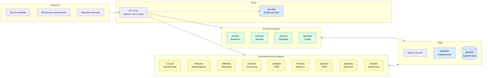

# Архитектура ERP-системы

Модули работают независимо и связаны только через ядро.

## Схема

Синий — компоненты ядра, зелёный — базовые модули, жёлтый — дополнительные.
API-шлюз и шина событий — инфраструктурные компоненты без кода.

## Схема кодов

Код состоит из трёх латинских букв и трёх цифр, например `FIN101`.

- **Буквы** — сокращение английского названия модуля.
- **Первая цифра** — группа: 0 — ядро, 1 — базовые модули, 2 — дополнительные.
- **Две последние цифры** — порядковый номер внутри группы.

## Модули

### Ядро

| Код | Компонент |
|---|---|
| `MDB001` | Единая база данных |
| `MDM002` | Справочники (НСИ) |
| `ACL003` | Права доступа |

### Базовые модули

| Код | Модуль | Состав |
|---|---|---|
| `FIN101` | Финансы и бухгалтерия | Главная книга, расчёты с дебиторами и кредиторами, казначейство, основные средства, налоговая отчётность |
| `PUR102` | Закупки | Заявки, выбор поставщиков, заказы, договоры, приёмка |
| `SAL103` | Продажи | Заказы клиентов, ценообразование, отгрузки, счета |
| `WHS104` | Склад и запасы | Остатки, перемещения, инвентаризация, партии и серийные номера |

### Дополнительные модули

| Код | Модуль | Состав |
|---|---|---|
| `CTL201` | Управленческий учёт (контроллинг) | Бюджетирование, учёт затрат, себестоимость, план-факт анализ |
| `MFG202` | Производство | Спецификации и маршруты, планирование потребностей (MRP), производственные заказы, загрузка мощностей |
| `HRM203` | Персонал (HRM) | Кадровый учёт, табель, расчёт зарплаты, подбор и обучение |
| `SCM204` | Логистика и цепочки поставок (SCM) | Планирование спроса, транспорт, доставка |
| `CRM205` | CRM | Клиентская база, воронка продаж, маркетинг, сервисные обращения |
| `PRJ206` | Проекты | Планирование, ресурсы, бюджеты и затраты по проектам |
| `EAM207` | Техобслуживание и ремонты (ТОиР/EAM) | Учёт оборудования, графики ремонтов, заявки |
| `QMS208` | Управление качеством | Входной контроль, проверки в производстве, несоответствия |
| `BIA209` | Аналитика и отчётность (BI) | Дашборды, консолидированные отчёты |
