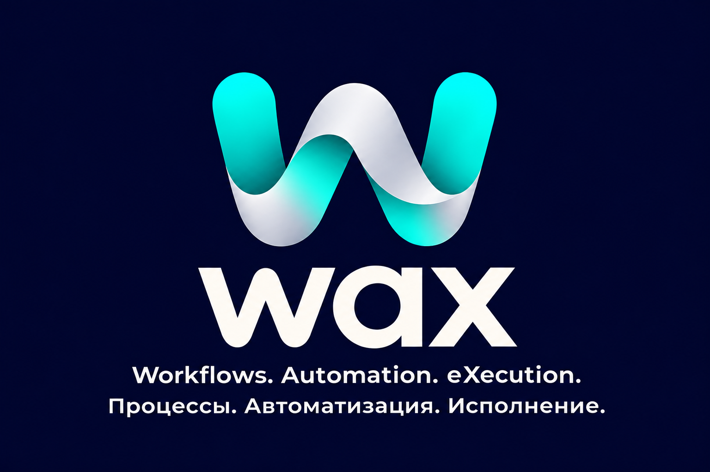
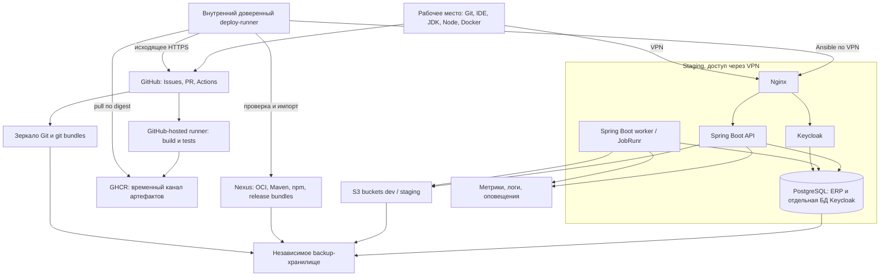

# wax — Инфраструктура разработки

**Домен портала:** [wax.su](https://wax.su)

**WAX — Workflows. Automation. eXecution.**

*Процессы. Автоматизация. Исполнение.*

<p align="left">
  
</p>


**Документ:** INFRA.md  
**Версия:** 0.1  
**Дата:** 14 ноября 2026 года  
**Статус:** проект инфраструктуры и план её реализации  
**Основание:** STACK.md 0.4, ARCHITECTURE.md, NFR.md 0.1  
**Проверенный срез main:** [2cc381e8fb0de0733a63c6392abbea988360735a](https://github.com/kvg20051/erp/tree/2cc381e8fb0de0733a63c6392abbea988360735a)

> Документ описывает целевую среду разработки. Исходного приложения, Compose-файлов, Ansible-плейбуков и CI workflows в проверенном срезе пока нет. Новые файлы и процедуры, перечисленные ниже, необходимо сначала реализовать. Инфраструктура в рамках подготовки документа не развёртывалась.

## Содержание

1. [Анализ репозитория](#repo)
2. [Принципы и границы](#principles)
3. [Среды и ресурсы](#environments)
4. [Схема инфраструктуры](#topology)
5. [Инструменты и версии](#versions)
6. [Рабочее место разработчика](#workstation)
7. [Сервисы и конфигурация](#services)
8. [Сеть, DNS и TLS](#network)
9. [База данных, миграции и задания](#data)
10. [Вложения и тестовые данные](#files)
11. [GitHub, Nexus и CI/CD](#cicd)
12. [Секреты и доступ](#secrets)
13. [Наблюдаемость](#observability)
14. [Резервирование и восстановление](#backup)
15. [Структура файлов](#layout)
16. [Подготовка и ежедневная работа](#workflow)
17. [Критерии готовности](#acceptance)
18. [Следующие фазы и открытые решения](#next)
19. [Источники](#sources)

<a id="repo"></a>
## 1. Анализ репозитория

В main присутствуют README.md, ARCHITECTURE.md, NFR.md, STACK.md, .gitignore, employees.csv и assets/branding. Код приложения, сборочные файлы и инфраструктурные конфигурации ещё не добавлены.

**Актуальный выбор — Java / Spring Boot.** Ранее подготовленный локальный TECH_STACK.md с вариантом .NET не используется как основание: в репозитории приняты более новые решения в STACK.md 0.4.

| Положение репозитория | Следствие для инфраструктуры |
|---|---|
| GitHub, один разработчик, свои VPS | Локальная разработка, изолированный staging, небольшой набор постоянных сервисов |
| Spring Boot / Spring Modulith | Модульный монолит; общая backend-сборка и явные режимы API/worker |
| PostgreSQL, JPA, jOOQ, Flyway | Один major БД во всех средах; тесты на настоящей PostgreSQL |
| Nginx | Входной прокси staging/production; Caddy из WUXU не переносится автоматически |
| Keycloak | Раздельные настройки входа и пользователи сред |
| S3 | Отдельные buckets и credentials; проверка на выбранном провайдере |
| GitHub Actions + внутренний runner + Nexus | Разделение сборки, импорта артефактов и привилегированного deploy |
| SOPS + age | Секреты в Git только зашифрованы; ключи расшифровки вне Git |
| РФ, ИТ-компания, HRM203 в фазе 1 | Синтетические тестовые данные; рабочие данные размещаются в РФ согласно принятому ограничению проекта |
| FIN101 исключён из первой версии | Бухгалтерия остаётся в 1С, интеграция — фаза 3 |
| Мобильный клиент — фаза 2 | OpenAPI готовится сразу; мобильный CI добавляется позднее |

Выявленные пробелы:

1. Нет каркаса, lock-файлов и зафиксированной матрицы версий.
2. .gitignore содержит базовые Java-исключения, но не покрывает .env, ключи и node_modules.
3. Не описан маршрут сборок из GitHub во внутренний Nexus.
4. Совместное размещение runner, Keycloak и Nexus на aux-1 требует разделения по полномочиям.
5. Не выбран S3-провайдер и способ согласованного восстановления файлов с БД.
6. Два приложения и реплика не заменяют проверенный failover входного узла, БД и остальных зависимостей.
7. Spring Modulith, outbox и JobRunr требуют явного распределения ответственности.

Основания: [STACK.md](https://github.com/kvg20051/erp/blob/2cc381e8fb0de0733a63c6392abbea988360735a/STACK.md), [ARCHITECTURE.md](https://github.com/kvg20051/erp/blob/2cc381e8fb0de0733a63c6392abbea988360735a/ARCHITECTURE.md), [NFR.md](https://github.com/kvg20051/erp/blob/2cc381e8fb0de0733a63c6392abbea988360735a/NFR.md).

<a id="principles"></a>
## 2. Принципы и границы

- Local, CI, staging и production имеют раздельные данные, ключи, учётные записи и конфигурацию.
- Production не используется для разработки, сборки или запуска Testcontainers.
- WUXU остаётся отдельной системой; его БД и ключи не становятся общими для ERP.
- Реальные кадровые данные не попадают в GitHub, CI, staging или AI-запросы.
- Инфраструктура воспроизводится из Git и резервных копий.
- Между средами продвигается один проверенный образ по digest.
- Работа production не зависит от доступности GitHub.
- Повторный deploy готового релиза без GitHub и полная автономная сборка — разные проверяемые сценарии.
- Все размеры VM ниже — первоначальные инженерные оценки.
- Работающий staging не является доказательством выполнения production NFR.

<a id="environments"></a>
## 3. Среды и ресурсы

### 3.1. Назначение

| Среда | Назначение | Данные |
|---|---|---|
| Local | Код, отладка, быстрые тесты | Синтетические, восстанавливаемые из seed |
| CI | Проверки каждой ветки | Одноразовые БД и fixtures |
| Staging | Контейнеры, миграции, сквозные сценарии | Синтетические, включая объёмы NFR |
| Production | Работа пользователей | Рабочие данные |
| Recovery sandbox | Проверка восстановления | Тестовые данные; production-копии только в отдельном защищённом режиме |

Staging должен позволять включить два API-экземпляра, проверить worker, миграции и восстановление. Полная отказоустойчивость production для повседневной разработки не требуется.

### 3.2. Минимальный запуск

| Узел | Предлагаемые ресурсы | Состав |
|---|---|---|
| Рабочий компьютер | 8 логических CPU, 32 ГБ RAM, 150 ГБ свободного SSD | IDE, JDK, Node.js, Docker |
| nixu-stg-01 | 4 vCPU, 8 ГБ RAM, 160 ГБ SSD | Nginx, API, worker с ограничением параллельности, PostgreSQL, Keycloak |
| Внешнее хранилище | По объёму данных | Отдельные S3 buckets и backup |

Первоначально deploy выполняется с рабочего места через VPN и Ansible. Это временный этап до автоматизации и внутреннего Nexus, а не конечное исполнение STACK.md.

Если на рабочем компьютере 16 ГБ RAM, контейнеры и Java-сборку можно перенести на отдельную dev VM. Одновременный запуск IDE, Android-эмулятора, Nexus и всего стека на таком компьютере не закладывается.

### 3.3. Среда регулярной разработки и релизов

| Узел | Предлагаемые ресурсы | Состав |
|---|---|---|
| nixu-stg-01 | 8 vCPU, 16 ГБ RAM, 200 ГБ SSD | Два API, worker, PostgreSQL, Keycloak, Nginx |
| nixu-tools-01 | 4 vCPU, 12 ГБ RAM, 250 ГБ SSD | Nexus, зеркало Git, мониторинг и логи |
| nixu-deploy-stg-01 | 2 vCPU, 4 ГБ RAM, 40 ГБ SSD | Доверенный deploy-runner, Ansible, импорт артефактов |
| Recovery VM | По необходимости | Восстановление и испытания отказов |
| S3 / backup | Отдельные пространства и полномочия | Вложения и резервные копии |

Итого для трёх постоянных VPS: **14 vCPU, 32 ГБ RAM, 490 ГБ SSD**, без рабочего компьютера, S3 и production. Переходить к этому варианту можно постепенно.

Nexus и мониторинг могут делить tools VM на старте. При конкуренции за память или диск они разделяются. Production-runner размещается отдельно от staging-runner и получает собственные credentials. Это уточнение схемы aux-1 из STACK.md.

<a id="topology"></a>
## 4. Схема инфраструктуры



Runner устанавливает исходящее соединение с GitHub; SSH production и Docker API не открываются для внешнего CI. Nginx отдаёт web и проксирует /api/. Worker не имеет пользовательского HTTP API.

<a id="versions"></a>
## 5. Инструменты и версии

| Компонент | Предлагаемая линия | Фиксация |
|---|---|---|
| VPS OS | Ubuntu 26.04 LTS, amd64 | Образ VM и Ansible |
| JDK | Eclipse Temurin 25 LTS | Toolchain, CI, base-image digest |
| Spring Boot | 4.1.x, стабильный patch | Parent/BOM |
| Spring Modulith | 2.1.x, совместимый patch | BOM + compatibility test |
| Maven | 3.9.x | Wrapper + checksum дистрибутива |
| PostgreSQL | 18.x | Одинаковый major, контейнер по digest |
| Node.js | 24 LTS, базовая линия проекта | Файл версии и CI |
| Frontend | React, TypeScript, Ant Design, TanStack Query, Vite | package.json + package-lock.json |
| Hibernate / jOOQ / Flyway | Совместимые с Boot и PostgreSQL | BOM либо явные версии |
| JobRunr | Стабильный выпуск со starter для Boot 4 | Версия, редакция, проверка функций |
| Keycloak / Nginx / Nexus | Поддерживаемые стабильные выпуски | infra/versions.yaml + image digest |
| Docker / Compose / Ansible | Проверенные стабильные версии | Пакеты и requirements |
| SOPS / age | Проверенные стабильные версии | Версия и checksum |
| JUnit / Testcontainers / Playwright / k6 | Совместимые стабильные версии | Maven/npm/digest |

Это матрица для прототипа, а не подтверждённая сборкой совместимость всех компонентов. Перед мобильной фазой Node.js сверяется с выбранным React Native.

Spring Boot 4.1 поддерживает Java 25; Spring Modulith 2.1 представлен стабильными выпусками. Жизненный цикл Spring Boot не равен LTS Java. Источники: [Boot](https://docs.spring.io/spring-boot/system-requirements.html), [Modulith](https://github.com/spring-projects/spring-modulith/releases), [Temurin](https://adoptium.net/support/), [Node.js](https://nodejs.org/en/about/previous-releases).

Правила:

- Нет latest/main/SNAPSHOT образов в staging/production.
- npm использует npm ci; Maven — зафиксированные версии и Wrapper.
- Security-обновления проходят CI и staging.
- Major-обновления PostgreSQL, Keycloak и Nexus имеют отдельную процедуру.
- infra/versions.yaml содержит версию, источник, digest/checksum, редакцию, лицензию и дату проверки.
- Spring Boot, Modulith и JobRunr проверяются совместно; формулировка «актуальная LTS» не применяется автоматически ко всем продуктам.

<a id="workstation"></a>
## 6. Рабочее место разработчика

Для текущего Windows-компьютера: **Windows + WSL2 Ubuntu + IDE с поддержкой WSL**. Исходники и кеши сборки размещаются в Linux-файловой системе WSL.

Docker используется одним способом: Docker Desktop с WSL integration либо Docker Engine в Linux. Два конкурирующих daemon для проекта не настраиваются. Ansible запускается из Linux/WSL.

Нужны Git, JDK, Node.js, Docker Compose, SOPS, age и SSH. Maven — через Wrapper проекта.

Проверки, которые можно выполнить до появления кода:

```bash
git --version
java -version
node --version
npm --version
docker version
docker compose version
sops --version
age --version
```

Получение репозитория:

```bash
git clone https://github.com/kvg20051/erp.git
cd erp
```

В текущем срезе clone скачает документацию, но не запустит ERP. Maven/Compose/frontend-команды добавляются вместе с каркасом. Docker на VPS устанавливается из официального источника; Ubuntu 26.04 входит в поддерживаемые ОС. [Инструкция Docker](https://docs.docker.com/engine/install/ubuntu/).

<a id="services"></a>
## 7. Сервисы и конфигурация

### Local с быстрой перезагрузкой

Backend/worker/Vite работают из IDE или терминала WSL; зависимости — в Docker.

| Сервис | Адрес | Назначение |
|---|---|---|
| Vite | http://localhost:5173 | Web; /api проксируется на backend |
| API | http://127.0.0.1:8080 | Отладка |
| Keycloak | http://localhost:8180 | Realm nixu-local |
| PostgreSQL | 127.0.0.1:5432 | Локальная БД и роли |
| SMTP test sink | Web 127.0.0.1:8025, SMTP 127.0.0.1:1025 | Перехват тестовых писем |
| Worker | Без внешнего порта | Фоновые операции |
| S3 | Отдельный dev endpoint/bucket | Синтетические файлы |

HTTP допускается только для local loopback. Staging/production — HTTPS.

Для dev S3 использовать отдельный bucket выбранного провайдера и лимит расходов. До выбора провайдера компонентные тесты могут подменять файловый адаптер; это не подтверждает реальную S3-совместимость.

### Контейнерный staging

- Nginx отдаёт web build и проксирует API.
- API и worker используют одну backend-версию с отдельными реализованными профилями.
- В API фоновая обработка отключена; обработчики выполняет worker.
- Keycloak работает в production-режиме с фиксированным hostname и PostgreSQL.
- Базы ERP и Keycloak разделены ролями и паролями.
- Конфигурация среды передаётся при запуске, без пересборки образа.

Frontend получает публичный runtime-config: URL API, OIDC issuer, client_id, имя среды. Секретов там нет. Пересборка Vite под каждую среду нарушила бы требование продвижения одного образа; env-зависимые значения выносятся из build в runtime-config.

### Health и завершение процессов

Отдельно проверяются liveness, readiness API, совместимость схемы БД, readiness Keycloak и heartbeat worker. Недоступность будущей 1С или WUXU не должна блокировать обычные учётные операции.

При обновлении процесс прекращает приём новой работы, даёт ограниченное время текущим операциям и позволяет безопасно повторить незавершённые задания.

<a id="network"></a>
## 8. Сеть, DNS и TLS

### Имена

Домен портала пилота — `wax.su`; его DNS-запись A должна указывать на VPS. Остальные имена ниже — шаблоны для отдельных сред и сервисов:

| Имя | Назначение |
|---|---|
| wax.su | Портал пилота; API под /api, Keycloak под /auth |
| nixu-stg.example.com | Web и API staging |
| auth-stg.example.com | Keycloak staging |
| nexus.example.com | Внутренний Nexus |
| registry.example.com | Внутренний OCI registry |
| grafana.example.com | Эксплуатационные панели |

В Ansible задано `nixu_domain: wax.su`; фактический IP VPS указывается в inventory. Настройка DNS и получение TLS-сертификата выполняются при развёртывании.

### Разрешённые соединения

| Источник | Получатель | Доступ |
|---|---|---|
| Разработчик через VPN | SSH узлов | TCP 22 с административных адресов |
| Тестировщик через VPN | Staging Nginx / Keycloak | TCP 443 |
| API / worker / Keycloak | Соответствующая БД | TCP 5432 по внутренней сети |
| API / worker | S3 endpoint | TCP 443 |
| Deploy-runner | GitHub / GHCR | Исходящий TCP 443 |
| Deploy-runner | Nexus / staging SSH | TCP 443 / 22 внутри контура |
| Monitoring | Метрики | Только необходимые private-порты |
| PostgreSQL | Backup repository | Выбранный защищённый транспорт |
| Интернет | БД, Docker socket, внутренние dashboards | Запрет |

WireGuard-порт, например UDP 51820, открывается только на VPN endpoint. Административные панели не публикуются ради удобства CI.

Опубликованные Docker-порты могут обходить ожидаемые ограничения UFW. Зависимости не публикуются на 0.0.0.0; применяются loopback/private bindings, firewall провайдера и правила для выбранного Docker backend. Результат проверяется извне. [Docker firewall limitations](https://docs.docker.com/engine/install/ubuntu/#firewall-limitations).

### TLS и OIDC

Для закрытого staging возможен публичный сертификат через DNS-01 без открытия порта 80. ACME-клиент и DNS-плагин выбираются после DNS-провайдера. Альтернатива — внутренняя CA с установленным доверием.

Nginx перезаписывает Forwarded/X-Forwarded-*; Keycloak доверяет только своему прокси. Между хостами используется защищённая сеть и, где требуется, TLS к upstream.

OIDC issuer должен совпадать для браузера и API. Нельзя выдавать браузеру auth-stg.example.com, а серверу задавать другой issuer keycloak:8080. В контейнерах настраиваются внутренний DNS и доверие JVM к сертификату.

Фиксируются конкретные redirect URI и web origins. Проверки: вход, выход, refresh, истечение токена и блокировка пользователя. Для NFR-S09 учитывается clock skew: номинальные 5 минут JWT плюс дополнительный допуск могут превысить предел 5 минут. TTL и допуски выбираются с запасом, отзыв подтверждается тестом.

Источники: [Keycloak hostname](https://www.keycloak.org/server/hostname), [Keycloak reverse proxy](https://www.keycloak.org/server/reverseproxy).

<a id="data"></a>
## 9. База данных, миграции и задания

### Роли и схемы

Для фазы 1 нужны схемы ядра, MDM, ACL, PUR, SAL, WHS, HRM, аудита и технических очередей. FIN и остальные модули не разворачиваются заранее.

| Роль | Полномочия |
|---|---|
| bootstrap | Первичная настройка, не используется приложением |
| nixu_migrator | DDL через deploy-процедуру |
| nixu_app | API без DDL и без изменения аудита |
| nixu_worker | Необходимые фоновой обработке операции |
| keycloak | Только БД Keycloak |
| monitoring | Ограниченное чтение статистики |
| backup | Права механизма резервирования |
| reporting | Позднее: согласованные read-only представления |

Схемы не гарантируют изоляцию модулей при общих runtime-правах. Границы дополнительно проверяются Spring Modulith. RLS тестируется под runtime-ролью, не владельцем таблиц или superuser.

### Миграции и jOOQ

- Flyway — единственный источник изменений ERP-схемы; Hibernate работает в режиме validate.
- Миграции выполняются один раз отдельным job, не каждым экземпляром при старте.
- Применённые миграции не редактируются.
- jOOQ-код генерируется из временной PostgreSQL после миграций, не из production.
- JPA/jOOQ используют согласованное управление транзакциями; смешанная запись проверяется integration-тестом.
- Неатомарные DDL выделяются с отдельной инструкцией повторного запуска.
- Проверяется совместимость приложения N−1 с расширенной схемой релиза N.
- Возврат приложения к предыдущему образу не равен откату БД.
- Пулы подключений API, worker, Keycloak и мигратора суммарно укладываются в лимит PostgreSQL с резервом для эксплуатации.

### Outbox, Modulith и JobRunr

Распределение ответственности:

1. Spring Modulith — границы и события; для надёжных асинхронных обработчиков настраивается Event Publication Registry.
2. Бизнес-outbox — события внешнего обмена/обработки, записанные с документом одной транзакцией.
3. JobRunr — исполнение фоновых работ и повторы.

Для каждого события определить источник истины, обработчик, ключ идемпотентности, retention и правила повтора. Три независимые очереди для одного события без необходимости не создаются.

**Запись документа и enqueue в JobRunr не считаются одной атомарной операцией по умолчанию.** Документация относит автоматическое участие в Spring-транзакциях к Pro. Базовый вариант: документ+outbox в одной транзакции, затем диспетчер ставит job; повторная постановка допустима, повторный бизнес-результат — нет. [JobRunr Spring Boot Starter](https://www.jobrunr.io/en/documentation/configuration/spring/).

Spring Modulith требует хранения и повторной обработки незавершённых публикаций. Обычный асинхронный listener сам этого не обеспечивает. [Spring Modulith events](https://docs.spring.io/spring-modulith/reference/events.html).

Для будущей 1С задаётся политика архивации событий. Историческая первичная загрузка в фазе 3 и текущий outbox — разные процессы; горячая очередь не растёт бессрочно.

<a id="files"></a>
## 10. Вложения и тестовые данные

### S3

Логические buckets: nixu-dev-files, nixu-stg-files, nixu-prod-files. Реальные имена могут требовать уникального суффикса. Production выделяется отдельными credentials и, желательно, проектом провайдера.

- БД хранит object key, version ID при наличии, checksum, размер и владельца.
- Нет анонимного чтения и listing.
- Операции пользователя проходят ACL.
- Presigned URL имеет ограниченные операцию и срок.
- S3 secret key не передаётся в web/mobile.
- Проверяются версии, большие файлы, тайм-ауты, удаление и восстановление.
- Versioning и репликация не заменяют независимый backup.
- Если браузер загружает напрямую, CORS ограничивается конкретными origins; при загрузке через API открывать CORS без причины не нужно.

Конкретный продукт пока не выбран в STACK.md. Для VPS-проекта базовое предложение — управляемый S3 российского провайдера; самостоятельный S3-кластер не добавляется только ради dev.

### Синтетические данные

Seed-генератор создаёт несколько организаций, роли, сотрудников, контрагентов и документы.

| Набор | Назначение |
|---|---|
| smoke | Минимальный сквозной процесс |
| permissions | Пользователи разных организаций и полномочий |
| concurrency | Конкурирующее изменение документа/остатка |
| load | 100 пользователей, 100 000 документов, 1 000 000 строк |
| recovery | Документы с файлами и заранее известными checksum |

employees.csv не импортируется автоматически и не является production-зависимостью. Его тестовое назначение нужно подтвердить; предпочтителен воспроизводимый генератор.

HRM-тесты охватывают карточку, поиск, экспорт, отчётность и вложения. Правовая классификация данных утверждается отдельно; этот документ не устанавливает юридические требования.

<a id="cicd"></a>
## 11. GitHub, Nexus и CI/CD

### Управление разработкой

Issues — требования и дефекты; Projects — план; Markdown — спецификации, ADR и runbooks; PR — изменение и проверки.

Для одного разработчика: main, короткие feature-ветки и release tags. Постоянная develop-ветка не обязательна. Защита main и доступность конкретных GitHub-функций проверяются в настройках аккаунта.

### Разделение контуров

| Контур | Разрешено | Недоступно |
|---|---|---|
| PR на GitHub-hosted | Build, lint, synthetic tests | age keys, private network, deploy credentials |
| Доверенный main/release на GitHub-hosted | Сборка, SBOM, публикация артефактов | Прямой доступ к production |
| Внутренний import/deploy | Проверка происхождения, Nexus, staging | Произвольный PR-код |
| Production deploy | Утверждённый manifest и playbook | Сборка и непроверенные пакеты из PR |

**Не регистрировать привилегированный persistent runner непосредственно в текущем публичном erp.** Рекомендуется отдельный приватный deployment-репозиторий с проверенным release manifest и контролируемыми workflow. Production и staging runners разделены.

Не исполнять PR-код с секретами через pull_request_target или аналогичную привилегированную цепочку. Сторонние Actions фиксируются по SHA. [GitHub Actions secure use](https://docs.github.com/en/actions/reference/security/secure-use).

### Маршрут образов

1. CI проверяет commit и один раз собирает backend/web для linux/amd64.
2. Публикует их в GHCR как временный канал и формирует release manifest.
3. Внутренний runner получает конкретные run и digest исходящим соединением.
4. Проверяет repository, commit, ref, результат обязательных проверок и provenance/подпись выбранного механизма.
5. Копирует OCI-образы в Nexus без пересборки, инструментом с сохранением manifest digest.
6. Сравнивает исходный и импортированный digest. Расхождение блокирует выпуск.
7. Разворачивает staging из Nexus.
8. После приёмки продвигает тот же manifest в production.

«Последний успешный образ» без commit/run и mutable tag не являются разрешением на deploy.

### Nexus

| Repository | Назначение |
|---|---|
| Maven proxy/group | Central и разрешённые внешние источники |
| Maven hosted | Собственные release-артефакты |
| npm proxy/group | npm-зависимости |
| Docker/OCI hosted | Проверенные wax и инфраструктурные образы |
| Docker proxy | Ускорение загрузок; не единственная копия release |
| Raw hosted | Manifests, SBOM, source bundles и инструменты |

Прокси-кеш не гарантирует автономность: нужных плагинов, пакетов и base images в нём может не быть. Для релиза формируется полный набор артефактов.

GitHub-hosted runner не имеет доступа к закрытому Nexus по умолчанию. Он использует внешние источники; внутренняя повторная сборка — Nexus. Открывать Nexus наружу только ради cache не требуется.

Выбор редакции и лимитов подтверждается до установки; коммерческие функции не предполагаются бесплатными. [Nexus Repository Types](https://help.sonatype.com/en/repository-types.html).

### Pipeline

| Этап | Результат |
|---|---|
| Validate | Форматирование, статический анализ, secret scanning |
| Backend | JUnit, Modulith boundaries, Testcontainers PostgreSQL |
| Frontend | TypeScript, компонентные тесты, сборка |
| Contract | OpenAPI, breaking-change diff, соответствие реализации |
| Schema | Flyway с нуля и с предыдущего релиза, jOOQ generation |
| Security | Зависимости, образы, SBOM |
| Package | Однократная release-сборка, digest |
| Import | Проверка происхождения, перенос в Nexus |
| Staging | Миграции, deploy, Playwright, smoke |
| Acceptance | Нагрузка и recovery при соответствующих рисках |
| Production | Явный запуск выпуска, smoke, наблюдение |

Полный NFR-нагрузочный тест не нужен на каждом PR. Он выполняется перед первым production и после изменений, влияющих на нагрузку/восстановление.

### Если GitHub недоступен

Для deploy хранить внутри контура: manifest, образы, Git mirror/bundles, Compose/Ansible, backup, SOPS ciphertext и отдельно доступные ключи.

Для полной сборки дополнительно нужны JDK, Node, Maven Wrapper distribution, Maven plugins, npm tarballs, Playwright browsers, base images, Testcontainers images и ОС-пакеты.

Git mirror не сохраняет Issues, Projects, Secrets и Actions artifacts. Критичные материалы экспортируются отдельно. Автономность проверяется с отключёнными GitHub и upstream registries; обычная успешная сборка с кешем недостаточна.

<a id="secrets"></a>
## 12. Секреты и доступ

SOPS шифрует файлы, age предоставляет ключевой материал. Ключи local/staging/production различаются. [Документация SOPS](https://getsops.io/docs/).

| Секрет | Ограничение |
|---|---|
| DB credentials | Отдельно app / worker / migrator |
| Keycloak credentials | Конкретная среда и задача |
| S3 credentials | Только нужный bucket и операции |
| age private key | Доверенный оператор/deploy-узел своей среды |
| Nexus credentials | Раздельные read и publish |
| SSH deploy key | Только необходимые узлы |
| HRM field-encryption key | Вне БД, с версией ключа |
| Backup key | Не только внутри самого backup-хранилища |

- В Git — encrypted files и безопасные examples.
- Plaintext не печатается в stdout, summary и artifacts.
- Runtime-файлы секретов имеют права 0600 и корректного владельца.
- Compose secrets доставляет файлы; сам по себе этот механизм не шифрует их на диске хоста.
- Ключи age и HRM имеют отдельную резервную копию.
- Для администраторов staging/production обязательна MFA.
- Docker socket и членство в docker group рассматриваются как привилегированный доступ к хосту.

Дополнить .gitignore исключениями для .env, приватных ключей, node_modules, target, dist, coverage и dumps. Безопасные .env.example и wrapper-файлы сохраняются в Git. Scanner проверяет и отслеживаемые файлы: .gitignore не устраняет уже закоммиченные секреты.

<a id="observability"></a>
## 13. Наблюдаемость

На local достаточно структурированных логов и health. На staging:

| Компонент | Роль |
|---|---|
| Actuator / Micrometer | Health, JVM/API metrics |
| OpenTelemetry | Trace/correlation context |
| Prometheus | Метрики |
| Alertmanager | Оповещения |
| Grafana | Панели |
| Loki + агент, например Grafana Alloy | Логи |
| Tempo, включаемый профиль | Хранилище traces при сквозной диагностике |

В STACK.md хранилище traces отдельно не определено. Tempo здесь — дополнение для согласования; Loki используется для логов.

Контроль: web/API/Keycloak availability, p95/5xx, длительность проведения, JDBC pool, locks, JVM/GC/OOM, outbox age, failed jobs, heartbeat worker, свободный диск, пригодность копий, WAL lag, S3 errors, сертификаты.

Начальные предлагаемые пороги: диск warning 75%, critical 85%; pending outbox старше 5 минут; отсутствие heartbeat worker более 2 минут. Пороги уточняются по измерениям.

Алерт проверяется искусственным отказом с целевым сроком NFR-O02. Доступность контролируется и с другого хоста. Логи/traces не содержат паспорта, токены, документы и строки подключения.

Начальный retention: staging logs 14 дней, traces 7 дней. Business audit production имеет отдельную политику.

<a id="backup"></a>
## 14. Резервирование и восстановление

| Объект | Предлагаемая политика |
|---|---|
| Local БД | Восстановление из seed |
| Git mirror / bundles | После изменений, минимум ежедневно |
| Staging БД | Ежедневная копия и точка перед рискованной миграцией |
| Nexus | Согласованные копии metadata и blob stores |
| Staging S3 | Retention и отдельные recovery-наборы |
| Production PostgreSQL | pgBackRest + WAL, RPO ≤ 15 минут |
| Production S3 | Независимая копия, измеряемое отставание согласно RPO |
| Ключи | Независимое защищённое хранение |

Файловая копия работающей БД/Nexus без поддерживаемой процедуры не считается консистентным backup. Снимок VPS не является единственной копией.

Проверка восстановления:

1. Подготовить чистую изолированную VM.
2. Получить release manifest и образы.
3. Восстановить PostgreSQL до выбранной точки, включая необходимые данные Keycloak.
4. Восстановить версии S3-объектов и сверить checksum.
5. Восстановить secrets и ключи шифрования.
6. Запустить совместимую версию приложения.
7. Проверить вход, права, документы, файлы и очередь.
8. До включения внешнего обмена сверить outbox/inbox: PITR не должен приводить к повторному выполнению уже принятой 1С операции.
9. Записать фактические RPO/RTO и отклонения.

Согласованное восстановление проверяет все подтверждённые ссылки на файлы в выбранной точке. Копирование S3 раз в сутки не обеспечивает RPO 15 минут. pgBackRest предоставляет backup/PITR; время зависит от данных и инфраструктуры. [pgBackRest](https://pgbackrest.org/user-guide.html).

Для production 99,5% — около 3 ч 36 мин простоя за 30 дней. RTO 4 часа не является допустимой длительностью каждого переключения.

До production отдельно проверить отказ входного узла, БД, Keycloak и S3. PostgreSQL failover включает изоляцию старого primary, проверку lag, promotion, смену подключения и восстановление реплики. Одновременная работа двух primary недопустима. Для первых экранов это не требуется, но до промышленной готовности процедура должна быть отрепетирована.

<a id="layout"></a>
## 15. Структура файлов

Целевая структура, которую предстоит добавить:

```text
erp/
├── README.md
├── ARCHITECTURE.md
├── NFR.md
├── STACK.md
├── INFRA.md
├── assets/branding/wax-logo.png
├── pom.xml
├── mvnw
├── mvnw.cmd
├── .mvn/wrapper/
├── backend/
├── apps/
│   ├── web/
│   └── mobile/                    # фаза 2
├── contracts/openapi/
├── tests/
│   ├── e2e/
│   ├── load/
│   └── fixtures/
├── docs/
│   ├── adr/
│   └── runbooks/
├── infra/
│   ├── versions.yaml
│   ├── compose/
│   │   ├── local.yaml
│   │   ├── staging.yaml
│   │   └── observability.yaml
│   ├── docker/
│   │   ├── backend.Dockerfile
│   │   └── web.Dockerfile
│   ├── nginx/
│   ├── keycloak/realm-template.json
│   ├── postgres/
│   ├── monitoring/
│   ├── ansible/
│   │   ├── inventories/example/
│   │   ├── roles/
│   │   └── site.yml
│   ├── config/
│   │   ├── local.env.example
│   │   └── staging.env.example
│   └── scripts/
├── .sops.yaml
└── .github/workflows/
    ├── ci.yml
    └── release.yml
```

Привилегированные deploy workflows, реальные inventory и encrypted secrets размещаются в приватном deployment-репозитории. В публичном erp остаются безопасные шаблоны и описание интерфейса.

| Компонент | Результат |
|---|---|
| local.yaml | Зависимости, loopback bindings, healthchecks |
| staging.yaml | Фиксированные образы и постоянные тома |
| realm-template.json | Без реальных пользователей и секретов |
| versions.yaml | Проверенные версии и digest |
| Backend Dockerfile | Multi-stage build, непривилегированный runtime |
| Web Dockerfile | Статическая сборка и публичный runtime-config |
| Ansible | Пользователи, пакеты, сеть, каталоги, Compose, backup; идемпотентный повтор |
| ci.yml | Проверки недоверенного кода без внутренних полномочий |
| release.yml | Доверенная сборка и публикация |
| Deploy-процедура | Проверка manifest, импорт, миграции, deploy |

<a id="workflow"></a>
## 16. Подготовка и ежедневная работа

### План задач

| ID | Приоритет | Задача | Критерий завершения |
|---|---|---|---|
| INFRA-01 | P0 | Версии, Wrapper, npm lock | Чистая машина получает тот же toolchain |
| INFRA-02 | P0 | .gitignore и secret scanner | Тестовый секрет блокирует PR |
| INFRA-03 | P0 | Boot + Modulith + web каркас | Сборка и health проходят |
| INFRA-04 | P0 | Local PostgreSQL, Keycloak, SMTP sink | Повторяемый запуск зависимостей |
| INFRA-05 | P0 | Flyway, роли, seed, jOOQ | Рабочая схема из пустой БД |
| INFRA-06 | P0 | CI с Testcontainers | Ошибка ACL/транзакции блокирует merge |
| INFRA-07 | P1 | Staging, VPN, DNS/TLS, Ansible | Deploy на чистую VM по инструкции |
| INFRA-08 | P1 | S3 staging и тесты адаптера | Загрузка, ACL, версии, recovery |
| INFRA-09 | P1 | Nexus, Git mirror, import | Проверенный digest есть в контуре |
| INFRA-10 | P1 | Приватный deployment-контур | PR не исполняется на deploy-runner |
| INFRA-11 | P1 | Outbox/JobRunr failure tests | Сбой commit→enqueue не теряет работу |
| INFRA-12 | P1 | Monitoring и backup | Отказ обнаружен, данные восстановлены |
| INFRA-13 | P2 | Нагрузка, два API, rollback | Протокол проверки NFR |
| INFRA-14 | P2 | Автономный redeploy | Релиз запущен без GitHub |

P0 — до активной разработки модулей; P1 — до регулярной приёмки на staging; P2 — до production.

### Интерфейс будущих команд

Это спецификация для infra/scripts. Сейчас таких скриптов в репозитории нет.

| Процедура | Назначение |
|---|---|
| doctor | Версии, Docker, свободное место, конфигурация |
| local-up | Запуск локальных зависимостей |
| db-migrate | Flyway под отдельной ролью |
| seed-demo | Синтетические данные; запрет запуска в production |
| test | Backend/frontend проверки |
| local-down | Остановка без удаления томов |
| local-reset | Подтверждаемый сброс только локальных тестовых данных |
| deploy-staging | Выпуск по проверенному manifest |
| smoke | Вход, API, сквозной сценарий |
| restore-test | Восстановление в отдельной изолированной среде |

### Ежедневный цикл после подготовки каркаса

1. Обновить main, создать ветку под Issue.
2. Выполнить doctor и local-up.
3. Применить миграции и seed.
4. Запустить API/worker из IDE и frontend dev server.
5. Изменить код, тесты, при необходимости OpenAPI и ADR.
6. Прогнать проверки и открыть PR.
7. После CI выполнить merge.
8. Собрать release один раз, импортировать в Nexus.
9. Развернуть staging и проверить критерии Issue.
10. Связать результат приёмки с commit/release.

Удаление томов не включается в обычную остановку. Reset staging не затрагивает production, Nexus и backup.

<a id="acceptance"></a>
## 17. Критерии готовности

### К разработке

- [ ] Новый компьютер собирает backend/web по документации.
- [ ] Local запускается без production-секретов.
- [ ] Миграции и seed работают на пустой PostgreSQL.
- [ ] Проверены issuer, redirect URI и MFA администратора.
- [ ] CI использует Testcontainers и не имеет внутренних полномочий.
- [ ] Тесты обнаруживают доступ к чужой организации и повторную обработку.
- [ ] Исходники и lock-файлы сохранены в Git.

### К регулярным релизам

- [ ] Staging разворачивается Ansible с чистой VM.
- [ ] Digest образов совпадает с прошедшими проверки.
- [ ] Credentials сред разделены.
- [ ] Nexus хранит текущий и предыдущий поддерживаемый release.
- [ ] Outbox переживает рестарт, job не дублирует бизнес-результат.
- [ ] Работают smoke, метрики и уведомления.
- [ ] Восстановлены БД и связанные файлы.
- [ ] Проверен возврат к предыдущему совместимому приложению.
- [ ] Пройден redeploy без GitHub.
- [ ] Зафиксированы неподтверждённые NFR и решения по ним.

CPU/RAM, p95 и RPO/RTO подтверждаются измерениями. При подготовке INFRA.md эти проверки не выполнялись.

<a id="next"></a>
## 18. Следующие фазы и открытые решения

### Фаза 2 — мобильное приложение

Добавить Android/iOS сборки. Для iOS нужен macOS/Xcode; Linux VPS его не заменяет. Signing/store credentials не выдаются обычному PR workflow. API поддерживает предыдущие согласованные версии клиентов; production-секреты не встраиваются в приложение.

### Фаза 3 — 1С

Сначала HTTP-stub в тестах, затем тестовая база 1С и ограниченный канал связи. Production 1С не используется для отладки. Проверяются master-data ownership, начальная загрузка, идемпотентность, сверка и повтор после PITR.

### Выбрать до развёртывания VPS

1. Провайдер/площадка РФ и приватная сеть либо WireGuard.
2. Домены staging/auth/registry.
3. S3-провайдер, версии объектов и независимый backup.
4. Минимальный или расширенный размер среды.
5. Достаточные редакции Nexus и JobRunr.
6. Канал эксплуатационных оповещений.
7. Retention образов, логов, backup и тестовых файлов.
8. Production failover и ответственный за переключение.

Эти вопросы не мешают создать локальный каркас, но должны быть решены до полной инфраструктурной закупки.

<a id="sources"></a>
## 19. Источники

Репозиторий проверен на срезе 2cc381e8fb0de0733a63c6392abbea988360735a. Внешняя документация проверена 14 ноября 2026 года; возможности продуктов перепроверяются при реализации.

- [Исходный репозиторий](https://github.com/kvg20051/erp/tree/2cc381e8fb0de0733a63c6392abbea988360735a)
- [Spring Boot: системные требования](https://docs.spring.io/spring-boot/system-requirements.html)
- [Spring Modulith: события](https://docs.spring.io/spring-modulith/reference/events.html)
- [Spring Modulith: выпуски](https://github.com/spring-projects/spring-modulith/releases)
- [JobRunr: Spring Boot Starter](https://www.jobrunr.io/en/documentation/configuration/spring/)
- [Docker: Ubuntu и firewall](https://docs.docker.com/engine/install/ubuntu/)
- [Keycloak: hostname](https://www.keycloak.org/server/hostname)
- [Keycloak: reverse proxy](https://www.keycloak.org/server/reverseproxy)
- [GitHub Actions: secure use](https://docs.github.com/en/actions/reference/security/secure-use)
- [Nexus: repository types](https://help.sonatype.com/en/repository-types.html)
- [SOPS](https://getsops.io/docs/)
- [pgBackRest](https://pgbackrest.org/user-guide.html)
- [Temurin](https://adoptium.net/support/)
- [Node.js: поддерживаемые линии](https://nodejs.org/en/about/previous-releases)
