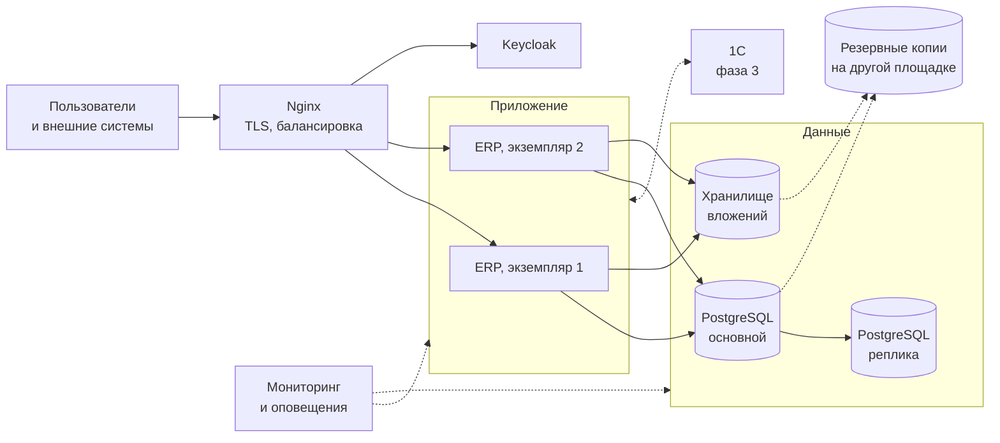

# Технологический стек ERP-системы

**Домен портала:** [wax.su](https://wax.su)

**WAX — Workflows. Automation. eXecution.**

*Процессы. Автоматизация. Исполнение.*

**Версия:** 0.4
**Статус:** предложение для согласования
**Основание:** `README.md` (модули), `ARCHITECTURE.md` (архитектура), `NFR.md` (нефункциональные требования)

## 1. Главное решение

Система строится как **модульный монолит на Java и Spring Boot с одной базой PostgreSQL**, без микросервисов, Kafka и Kubernetes.

Причины:

- **Нагрузка небольшая.** 100 пользователей, 30 одновременно, 10 запросов в секунду (NFR, раздел 2). Один экземпляр приложения справляется с запасом; второй нужен для отказоустойчивости, а не для производительности.
- **Учётные операции должны быть атомарными** (NFR-D01). В одной базе это обычная транзакция. В микросервисах пришлось бы строить распределённые транзакции.
- **Архитектура уже предполагает единую базу** (`MDB001`) и связь модулей только через ядро.
- **Размещение на своих VM.** Чем меньше отдельных сервисов, тем проще выполнить восстановление за 4 часа (NFR-A03) и сопровождать систему небольшой командой.

Конкретные версии компонентов фиксируются при старте проекта: берутся актуальные LTS-выпуски.

### Принятые решения

| Вопрос | Решение |
|---|---|
| Язык бэкенда | Java |
| Мобильный клиент | Отдельное приложение |
| Площадка разработки | GitHub |
| Юрисдикция | Российская Федерация |
| Отрасль | ИТ-компания |
| Размещение | VPS |
| Первая внешняя система | 1С, в фазе 3 |

### Состав первой версии

| Код | Модуль | Замечание |
|---|---|---|
| `MDB001` | Единая база данных | |
| `MDM002` | Справочники (НСИ) | Нужно определить, какая система главная по каждому справочнику: ERP или 1С |
| `ACL003` | Права доступа | |
| `PUR102` | Закупки | |
| `SAL103` | Продажи | |
| `WHS104` | Склад и запасы | |
| `HRM203` | Персонал | С первой версии в системе есть персональные данные сотрудников |

`FIN101` в первую версию не входит, а интеграция с 1С запланирована на фазу 3. Значит, в фазах 1 и 2 бухгалтерский учёт ведётся в 1С отдельно, и документы закупок и продаж переносятся туда вручную.

### Фазы

| Фаза | Содержание |
|---|---|
| 1 | Ядро, `PUR102`, `SAL103`, `WHS104`, `HRM203`, веб-клиент |
| 2 | Мобильное приложение |
| 3 | Интеграция с 1С |
| Далее | Остальные модули по отдельному плану |

## 2. Стек по слоям

| Слой | Выбор | Зачем |
|---|---|---|
| Язык и платформа | Java (актуальная LTS), Spring Boot | Зрелая экосистема для учётных систем, `BigDecimal` для денег, большой рынок разработчиков |
| Границы модулей | Spring Modulith | Проверяет в тестах, что модули не лезут друг в друга; даёт события между модулями с гарантией доставки |
| База данных | PostgreSQL, отдельная схема на каждый модуль | Транзакции, `NUMERIC` для денег, полнотекстовый поиск, репликация |
| Доступ к данным | Hibernate (JPA) для документов, jOOQ для списков и отчётов | JPA удобен для записи документов; jOOQ даёт точный контроль над тяжёлыми запросами |
| Миграции БД | Flyway | Версионируемые миграции в репозитории (NFR-M05) |
| Шина событий | События Spring Modulith + таблица outbox в PostgreSQL | Событие пишется в той же транзакции, что и документ, и не теряется при сбое (NFR-D07) |
| Фоновые задачи | JobRunr, очередь в PostgreSQL | Отчёты, импорты, повторные попытки интеграций со статусом выполнения (NFR-P04) |
| Аутентификация | Keycloak (OIDC) | Вход, MFA для администраторов, защита от перебора, отзыв сессий (NFR-S03, S04, S09) |
| Авторизация | Модуль `ACL003` внутри приложения | Роли, юридические лица и область данных проверяются на сервере для всех каналов (NFR-S01, S02) |
| API | REST, контракт OpenAPI в репозитории | Один API для веба, мобильного клиента и внешних систем (NFR-I01) |
| Вход в систему | Nginx | TLS, балансировка между экземплярами, ограничение частоты запросов |
| Веб-клиент | TypeScript, React, Ant Design, TanStack Query | Готовые таблицы и формы для учётных интерфейсов, русская локализация |
| Мобильный клиент (фаза 2) | React Native, отдельное приложение для iOS и Android | Общий с вебом язык и сгенерированный клиент API; распространение через App Store, Google Play и RuStore |
| Интеграция с 1С (фаза 3) | Отдельный модуль-адаптер в приложении; обмен по HTTP через очередь фоновых задач | Недоступность 1С не останавливает работу в ERP; документы не теряются и не дублируются (NFR-A06, D07) |
| Вложения | S3-совместимое хранилище | Файлы доступны обоим экземплярам приложения; версии и репликация для резервирования |
| Аналитика `BIA209` (после фазы 1) | Реплика PostgreSQL + Apache Superset | Отчёты не нагружают основную базу; отдельное хранилище данных не нужно |
| Поиск | Полнотекстовый поиск PostgreSQL и `pg_trgm` | На 100 000 документов отдельный поисковый движок не нужен |
| Резервное копирование | pgBackRest с архивом WAL | Восстановление на момент времени, шифрование, хранение вне основного сервера (NFR-A02, A04) |
| Наблюдаемость | OpenTelemetry, Prometheus, Grafana, Loki, Alertmanager | Метрики, логи, трассировка по идентификатору запроса, оповещения (NFR-O01, O02) |
| Развёртывание | Docker-образы, Docker Compose, Ansible | Один и тот же образ на staging и production (NFR-M04) |
| CI/CD | GitHub Actions; развёртывание через собственный runner внутри контура | Сборка и тесты идут в GitHub, а доступ к серверам production снаружи не открывается |
| Реестр образов и зависимостей | Собственный реестр в контуре (например, Nexus) с копиями образов и библиотек | Развёртывание и восстановление не зависят от доступности зарубежных реестров |
| Секреты | SOPS с ключами age, отдельные ключи на каждую среду | Секреты не лежат в репозитории открытым текстом (NFR-S06) |
| Тесты | JUnit, Testcontainers, Playwright, k6 | Тесты на настоящей PostgreSQL, сквозные сценарии, нагрузочные испытания |

## 3. Как стек реализует архитектуру

| Блок из `ARCHITECTURE.md` | Реализация |
|---|---|
| Клиенты: веб, мобильное приложение, внешние системы | React в фазе 1, React Native в фазе 2, REST API с токенами; 1С подключается в фазе 3 |
| API-шлюз | Nginx плюс общий слой API в приложении: проверка токена, идентификатор запроса, единый формат ошибок |
| `ACL003` Права доступа | Модуль приложения; Keycloak отвечает только за вход |
| Базовые и дополнительные модули | Модули Spring Modulith в одном приложении, у каждого своя схема в базе |
| Шина событий | События внутри процесса с записью в outbox; отдельный брокер не нужен |
| `MDM002` Справочники | Модуль ядра; остальные модули обращаются к нему через его публичный интерфейс |
| `MDB001` Единая база | Один кластер PostgreSQL: основной сервер и реплика |

Модуль не читает таблицы чужой схемы напрямую. Он либо вызывает публичный интерфейс другого модуля, либо подписывается на его события. Это правило проверяется автоматически в CI.

## 4. Схема размещения в production

### Размещение на VPS

Предварительная оценка для заявленной нагрузки; её нужно проверить нагрузочными испытаниями.

| VPS | Назначение | Ресурсы |
|---|---|---|
| app-1, app-2 | Nginx и приложение | 4 vCPU, 8 ГБ ОЗУ каждая |
| db-1 | PostgreSQL, основной | 4 vCPU, 16 ГБ ОЗУ, NVMe от 200 ГБ |
| db-2 | PostgreSQL, реплика | Как db-1 |
| aux-1 | Keycloak, мониторинг, реестр образов, runner CI | 4 vCPU, 8–16 ГБ ОЗУ |

Правила размещения:

- **Провайдер в России.** Все VPS, резервные копии и вложения находятся в российских дата-центрах (раздел 8).
- **Разнесение.** Основная база и реплика стоят в разных дата-центрах или зонах, иначе авария площадки выводит из строя обе. Резервные копии хранятся у другого провайдера.
- **Закрытая сеть.** VPS общаются между собой по приватной сети провайдера или через WireGuard. Наружу открыты только 443 и SSH с доверенных адресов.
- **Firewall и Docker.** Порты, опубликованные контейнерами, обходят UFW. Сервисы публикуются только на внутренних адресах.
- **Снимки VPS не заменяют резервные копии.** RPO 15 минут обеспечивает только архив WAL (NFR-A02).
- **Вложения.** Проще всего взять объектное хранилище S3 у российского провайдера вместо собственного сервиса на VPS.

## 5. Ключевые решения по требованиям

### Целостность данных

- **Проведение документа** — одна транзакция PostgreSQL: документ, движения и запись события фиксируются вместе (NFR-D01, D07).
- **Идемпотентность** — клиент передаёт заголовок `Idempotency-Key`; ключ и результат хранятся в базе с уникальным ограничением (NFR-D02, I05).
- **Конфликты редактирования** — поле версии в каждой записи и оптимистичная блокировка; второй пользователь получает ошибку 409 (NFR-D03).
- **Деньги** — `NUMERIC` в базе и `BigDecimal` в коде; правила округления собраны в одном общем классе (NFR-D04).
- **Даты** — технические метки в `timestamptz` (UTC), учётные даты в `date` (NFR-D08).
- **Исправления** — проведённые документы не редактируются, а сторнируются новым документом со ссылкой на исходный (NFR-D05).

### Безопасность

- **Юридические лица** — фильтр по организации в слое доступа к данным. Вторая линия защиты — политики Row-Level Security в PostgreSQL (NFR-S01).
- **Отзыв доступа** — токены доступа живут не дольше 5 минут; блокировка в Keycloak прекращает выдачу новых (NFR-S09).
- **Аудит** — отдельная схема с таблицей только на добавление; у роли приложения нет прав на изменение и удаление. Таблица разбита по месяцам, хранение от 12 месяцев (NFR-S07, S08).
- **Персональные данные** — чувствительные поля (например, номер паспорта в `HRM203`) шифруются на уровне поля и не попадают в логи (NFR-O03).

### Доступность и восстановление

- **RPO 15 минут** — непрерывный архив WAL через pgBackRest плюс потоковая реплика. Вложения резервируются отдельно: версии объектов и репликация хранилища (NFR-A02).
- **RTO 4 часа** — развёртывание чистой VM плейбуком Ansible и восстановление из pgBackRest; сценарий проверяется раз в квартал (NFR-A03, A05).
- **Доступность 99,5%** — это около 3,6 часа простоя в месяц. Одно восстановление из копии за 4 часа уже выходит за этот предел, поэтому реплика с ручным переключением обязательна (NFR-A01).

### API

- **Контракт** — файл OpenAPI в репозитории является источником истины. Из него генерируются клиент для веба и мобильного приложения; CI сравнивает контракт с реализацией и ловит несовместимые изменения (NFR-I01, I02).
- **Ошибки** — формат Problem Details (RFC 9457) с машинным кодом и идентификатором запроса (NFR-I03).
- **Списки** — серверная пагинация с ограничением размера страницы (NFR-P05).
- **Внешние системы** — вызовы с тайм-аутами; повторные попытки идут через очередь фоновых задач (NFR-A06).

### Интеграция с 1С (фаза 3)

Что закладывается уже в фазе 1, чтобы фаза 3 не потребовала переделок:

- **Outbox с первого дня.** События о проведённых документах пишутся в outbox, даже пока их никто не забирает.
- **Поля для сопоставления.** В справочниках и документах есть поле внешнего идентификатора, а у контрагентов — ИНН и КПП, чтобы потом сопоставить записи с 1С.
- **Выгрузка в файл.** Документы закупок и продаж можно выгрузить в Excel или CSV. Это уменьшает ручной ввод в 1С в фазах 1 и 2 и не требует доработки 1С.

Как интеграция устроена в фазе 3:

- **Направление в 1С.** Проведённые документы закупок и продаж попадают в outbox и передаются в 1С фоновыми задачами с повторами. У каждой передачи есть ключ идемпотентности, чтобы повтор не создал дубликат в 1С.
- **Направление из 1С.** Оплаты, статусы и изменения справочников ERP получает по расписанию или по вызову со стороны 1С через тот же REST API.
- **Способ подключения.** Со стороны 1С используются HTTP-сервисы или стандартный интерфейс OData. Выбор зависит от конфигурации и версии 1С и от того, кто дорабатывает 1С.
- **Главная система по данным.** Для каждого справочника (контрагенты, номенклатура, сотрудники) назначается одна главная система; вторая только получает изменения. Без этого правила справочники разойдутся.
- **Сверка.** Нужен регулярный отчёт расхождений между ERP и 1С по документам и остаткам.
- **Расчёт зарплаты.** В состав `HRM203` входит расчёт зарплаты. В России его обычно ведут в 1С из-за частых изменений законодательства. Предложение: в первой версии `HRM203` покрывает кадровый учёт и табель, а зарплата считается в 1С.

### Выпуск изменений

- **Один образ** — CI собирает Docker-образ один раз; на staging и в production он разворачивается по digest (NFR-M04).
- **Миграции** — только совместимые с предыдущей версией приложения (сначала расширение схемы, потом удаление старого). Это делает возможным откат приложения без отката базы (NFR-M05, M06).
- **Обязательные тесты в CI** — учётные операции, права, идемпотентность, конкурентное изменение, границы модулей (NFR-M02).

## 6. Что не берём на старте

| Технология | Почему нет | Когда вернуться к вопросу |
|---|---|---|
| Микросервисы | Ломают атомарность проведения, кратно усложняют эксплуатацию | Если отдельный модуль потребует независимого масштабирования или отдельной команды |
| Kafka, RabbitMQ | При 10 запросах в секунду outbox в PostgreSQL достаточно | Если появятся потоки событий в тысячи в секунду или много внешних подписчиков |
| Kubernetes | Для двух экземпляров приложения на своих VM избыточен | Если число сервисов и сред заметно вырастет |
| Redis | Сессий на сервере нет, кэш пока не нужен | Если нагрузочные тесты покажут узкое место |
| Elasticsearch | Поиска PostgreSQL хватает на заявленный объём | Если понадобится поиск по содержимому вложений |
| Отдельное хранилище данных | Отчёты строятся на реплике | Если отчёты начнут мешать репликации или понадобится история срезов |

## 7. Риски и оговорки

- **Мобильный клиент.** Приложение перенесено в фазу 2, но API проектируется под него уже в фазе 1: контракт OpenAPI, идемпотентность, версионирование. Отдельное приложение означает второй цикл выпуска и поддержку нескольких версий клиента одновременно (NFR-I02, I06).
- **Двойной ввод в фазах 1 и 2.** До фазы 3 документы вносятся и в ERP, и в 1С вручную. Это дополнительная работа бухгалтерии и источник расхождений; чем дольше длятся фазы 1 и 2, тем больше накопится несовпадений, которые придётся разбирать при подключении.
- **Состав модулей и отрасль.** Для ИТ-компании продажи — это в основном услуги и договоры, а склад — оборудование и лицензии. `SAL103` и `WHS104` нужно проектировать под эти сценарии, а не под отгрузку товаров. Модуль проектов `PRJ206` для такой компании обычно важнее склада; его стоит учесть в плане следующих фаз.
- **VPS.** Производительность дисков у VPS нестабильна и зависит от соседей по серверу. Показатели NFR-P01 и P02 нужно проверять на тех же тарифах, что будут в production.
- **Зависимость от GitHub.** Код и CI находятся на зарубежной площадке. На случай ограничения доступа нужно зеркало репозитория в контуре и возможность собрать и развернуть выпуск без GitHub.
- **Хранилище вложений.** Конкретный продукт (SeaweedFS, Garage, MinIO или S3 провайдера) нужно выбрать после проверки текущих лицензий и статуса поддержки.
- **JobRunr.** Часть возможностей есть только в платной редакции; перед выбором нужно сверить, хватает ли открытой. Запасной вариант — db-scheduler.
- **Числа из NFR не согласованы.** Стек рассчитан на заявленные 100 пользователей. При росте на порядок первым пересматривается раздел 6.

## 8. Требования юрисдикции РФ

Это технические следствия, а не юридическое заключение; состав обязательных мер нужно подтвердить с юристом или специалистом по защите информации.

- **Размещение данных.** 152-ФЗ требует хранить персональные данные граждан России в базах на территории РФ. Production, реплика, резервные копии и хранилище вложений размещаются на серверах в России.
- **Персональные данные вне production.** В GitHub, в CI и на staging используются только синтетические данные. Копии production-базы для тестов обезличиваются.
- **Меры защиты.** Система, где обрабатываются данные сотрудников и клиентов, подпадает под требования к защите персональных данных (постановление Правительства № 1119, приказ ФСТЭК № 21). Уровень защищённости определяется отдельно; от него зависят требования к средствам защиты и журналированию.
- **Независимость от зарубежных сервисов.** Образы, библиотеки и исходный код дублируются в контуре (раздел 2), чтобы восстановление за 4 часа не зависело от внешних площадок.
- **Мобильное приложение.** Кроме App Store и Google Play нужен канал, не зависящий от них: RuStore или корпоративное распространение. Push-уведомления проектируются так, чтобы приложение работало и без них.
- **Локальные особенности учёта.** Валюта учёта — рубль, несколько часовых поясов, российские формы первичных документов и отчётности. Это влияет на `FIN101` и `HRM203`, но не на стек.
- **Провайдер VPS.** Провайдер получает доступ к инфраструктуре с персональными данными, поэтому с ним обычно оформляют поручение на обработку. Это нужно подтвердить с юристом.
- **Интеграции.** Первая — 1С, в фазе 3 (раздел 5). Банки и ЭДО остаются на стороне 1С. Если позже они понадобятся в ERP, подключение идёт через ту же очередь фоновых задач (NFR-A06).

## 9. Замечание по `employees.csv`

Файл выглядит как тестовые данные: телефоны с кодом 555, адреса «Example Way», номера паспортов подряд. В нём есть колонка с номером паспорта. Реальные данные сотрудников в репозиторий попадать не должны, особенно в публичный (NFR-S06). Для тестов достаточно синтетического набора, который генерируется скриптом.

## 10. Что осталось решить до старта разработки

1. Где считается зарплата: в `HRM203` или в 1С.
2. Нужна ли в фазе 1 выгрузка документов в файл для ручной загрузки в 1С.
3. Что именно продаёт и хранит на складе компания: от этого зависит содержание `SAL103` и `WHS104`.
4. Какой провайдер VPS и есть ли у него несколько дата-центров в России и объектное хранилище.

К фазе 3 нужно будет определить конфигурацию и версию 1С, способ подключения и главную систему по каждому справочнику.
