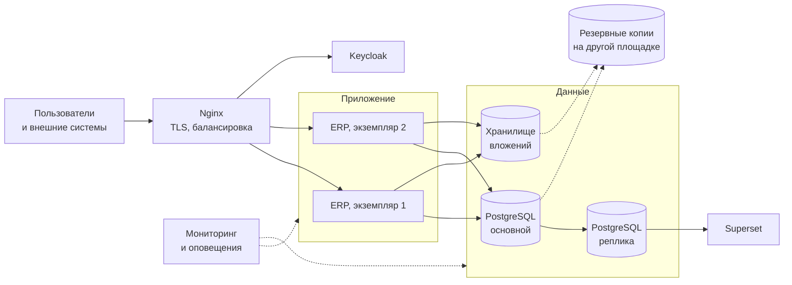

# Технологический стек ERP-системы

**Версия:** 0.1
**Статус:** предложение для согласования
**Основание:** `README.md` (модули), `ARCHITECTURE.md` (архитектура), `NFR.md` (нефункциональные требования)

## 1. Главное решение

Система строится как **модульный монолит на Java и Spring Boot с одной базой PostgreSQL**, без микросервисов, Kafka и Kubernetes.

Причины:

- **Нагрузка небольшая.** 100 пользователей, 30 одновременно, 10 запросов в секунду (NFR, раздел 2). Один экземпляр приложения справляется с запасом; второй нужен для отказоустойчивости, а не для производительности.
- **Учётные операции должны быть атомарными** (NFR-D01). В одной базе это обычная транзакция. В микросервисах пришлось бы строить распределённые транзакции.
- **Архитектура уже предполагает единую базу** (`MDB001`) и связь модулей только через ядро.
- **Размещение на своих VM.** Чем меньше отдельных сервисов, тем проще выполнить восстановление за 4 часа (NFR-A03) и сопровождать систему небольшой командой.

Конкретные версии компонентов фиксируются при старте проекта: берутся актуальные LTS-выпуски.

## 2. Стек по слоям

| Слой | Выбор | Зачем |
|---|---|---|
| Язык и платформа | Java (актуальная LTS), Spring Boot | Зрелая экосистема для учётных систем, `BigDecimal` для денег, большой рынок разработчиков |
| Границы модулей | Spring Modulith | Проверяет в тестах, что модули не лезут друг в друга; даёт события между модулями с гарантией доставки |
| База данных | PostgreSQL, отдельная схема на каждый модуль | Транзакции, `NUMERIC` для денег, полнотекстовый поиск, репликация |
| Доступ к данным | Hibernate (JPA) для документов, jOOQ для списков и отчётов | JPA удобен для записи документов; jOOQ даёт точный контроль над тяжёлыми запросами |
| Миграции БД | Flyway | Версионируемые миграции в репозитории (NFR-M05) |
| Шина событий | События Spring Modulith + таблица outbox в PostgreSQL | Событие пишется в той же транзакции, что и документ, и не теряется при сбое (NFR-D07) |
| Фоновые задачи | JobRunr, очередь в PostgreSQL | Отчёты, импорты, повторные попытки интеграций со статусом выполнения (NFR-P04) |
| Аутентификация | Keycloak (OIDC) | Вход, MFA для администраторов, защита от перебора, отзыв сессий (NFR-S03, S04, S09) |
| Авторизация | Модуль `ACL003` внутри приложения | Роли, юридические лица и область данных проверяются на сервере для всех каналов (NFR-S01, S02) |
| API | REST, контракт OpenAPI в репозитории | Один API для веба, мобильного клиента и внешних систем (NFR-I01) |
| Вход в систему | Nginx | TLS, балансировка между экземплярами, ограничение частоты запросов |
| Веб-клиент | TypeScript, React, Ant Design, TanStack Query | Готовые таблицы и формы для учётных интерфейсов, русская локализация |
| Мобильный клиент | React Native | Общий с вебом язык и сгенерированный клиент API |
| Вложения | S3-совместимое хранилище | Файлы доступны обоим экземплярам приложения; версии и репликация для резервирования |
| Аналитика `BIA209` | Реплика PostgreSQL + Apache Superset | Отчёты не нагружают основную базу; отдельное хранилище данных на старте не нужно |
| Поиск | Полнотекстовый поиск PostgreSQL и `pg_trgm` | На 100 000 документов отдельный поисковый движок не нужен |
| Резервное копирование | pgBackRest с архивом WAL | Восстановление на момент времени, шифрование, хранение вне основного сервера (NFR-A02, A04) |
| Наблюдаемость | OpenTelemetry, Prometheus, Grafana, Loki, Alertmanager | Метрики, логи, трассировка по идентификатору запроса, оповещения (NFR-O01, O02) |
| Развёртывание | Docker-образы, Docker Compose, Ansible | Один и тот же образ на staging и production (NFR-M04) |
| CI/CD | GitHub Actions, реестр образов GitHub | Репозиторий уже на GitHub; при переезде на GitLab заменяется на GitLab CI |
| Секреты | SOPS с ключами age, отдельные ключи на каждую среду | Секреты не лежат в репозитории открытым текстом (NFR-S06) |
| Тесты | JUnit, Testcontainers, Playwright, k6 | Тесты на настоящей PostgreSQL, сквозные сценарии, нагрузочные испытания |

## 3. Как стек реализует архитектуру

| Блок из `ARCHITECTURE.md` | Реализация |
|---|---|
| Клиенты: веб, мобильное приложение, внешние системы | React, React Native, REST API с токенами |
| API-шлюз | Nginx плюс общий слой API в приложении: проверка токена, идентификатор запроса, единый формат ошибок |
| `ACL003` Права доступа | Модуль приложения; Keycloak отвечает только за вход |
| Базовые и дополнительные модули | Модули Spring Modulith в одном приложении, у каждого своя схема в базе |
| Шина событий | События внутри процесса с записью в outbox; отдельный брокер не нужен |
| `MDM002` Справочники | Модуль ядра; остальные модули обращаются к нему через его публичный интерфейс |
| `MDB001` Единая база | Один кластер PostgreSQL: основной сервер и реплика |

Модуль не читает таблицы чужой схемы напрямую. Он либо вызывает публичный интерфейс другого модуля, либо подписывается на его события. Это правило проверяется автоматически в CI.

## 4. Схема размещения в production

Минимальный состав: две VM под приложение, две под базу, одна под мониторинг и вспомогательные сервисы. Резервные копии хранятся на другой площадке.

## 5. Ключевые решения по требованиям

### Целостность данных

- **Проведение документа** — одна транзакция PostgreSQL: документ, движения и запись события фиксируются вместе (NFR-D01, D07).
- **Идемпотентность** — клиент передаёт заголовок `Idempotency-Key`; ключ и результат хранятся в базе с уникальным ограничением (NFR-D02, I05).
- **Конфликты редактирования** — поле версии в каждой записи и оптимистичная блокировка; второй пользователь получает ошибку 409 (NFR-D03).
- **Деньги** — `NUMERIC` в базе и `BigDecimal` в коде; правила округления собраны в одном общем классе (NFR-D04).
- **Даты** — технические метки в `timestamptz` (UTC), учётные даты в `date` (NFR-D08).
- **Исправления** — проведённые документы не редактируются, а сторнируются новым документом со ссылкой на исходный (NFR-D05).

### Безопасность

- **Юридические лица** — фильтр по организации в слое доступа к данным. Вторая линия защиты — политики Row-Level Security в PostgreSQL (NFR-S01).
- **Отзыв доступа** — токены доступа живут не дольше 5 минут; блокировка в Keycloak прекращает выдачу новых (NFR-S09).
- **Аудит** — отдельная схема с таблицей только на добавление; у роли приложения нет прав на изменение и удаление. Таблица разбита по месяцам, хранение от 12 месяцев (NFR-S07, S08).
- **Персональные данные** — чувствительные поля (например, номер паспорта в `HRM203`) шифруются на уровне поля и не попадают в логи (NFR-O03).

### Доступность и восстановление

- **RPO 15 минут** — непрерывный архив WAL через pgBackRest плюс потоковая реплика. Вложения резервируются отдельно: версии объектов и репликация хранилища (NFR-A02).
- **RTO 4 часа** — развёртывание чистой VM плейбуком Ansible и восстановление из pgBackRest; сценарий проверяется раз в квартал (NFR-A03, A05).
- **Доступность 99,5%** — это около 3,6 часа простоя в месяц. Одно восстановление из копии за 4 часа уже выходит за этот предел, поэтому реплика с ручным переключением обязательна (NFR-A01).

### API

- **Контракт** — файл OpenAPI в репозитории является источником истины. Из него генерируются клиент для веба и мобильного приложения; CI сравнивает контракт с реализацией и ловит несовместимые изменения (NFR-I01, I02).
- **Ошибки** — формат Problem Details (RFC 9457) с машинным кодом и идентификатором запроса (NFR-I03).
- **Списки** — серверная пагинация с ограничением размера страницы (NFR-P05).
- **Внешние системы** — вызовы с тайм-аутами; повторные попытки идут через очередь фоновых задач (NFR-A06).

### Выпуск изменений

- **Один образ** — CI собирает Docker-образ один раз; на staging и в production он разворачивается по digest (NFR-M04).
- **Миграции** — только совместимые с предыдущей версией приложения (сначала расширение схемы, потом удаление старого). Это делает возможным откат приложения без отката базы (NFR-M05, M06).
- **Обязательные тесты в CI** — учётные операции, права, идемпотентность, конкурентное изменение, границы модулей (NFR-M02).

## 6. Что не берём на старте

| Технология | Почему нет | Когда вернуться к вопросу |
|---|---|---|
| Микросервисы | Ломают атомарность проведения, кратно усложняют эксплуатацию | Если отдельный модуль потребует независимого масштабирования или отдельной команды |
| Kafka, RabbitMQ | При 10 запросах в секунду outbox в PostgreSQL достаточно | Если появятся потоки событий в тысячи в секунду или много внешних подписчиков |
| Kubernetes | Для двух экземпляров приложения на своих VM избыточен | Если число сервисов и сред заметно вырастет |
| Redis | Сессий на сервере нет, кэш пока не нужен | Если нагрузочные тесты покажут узкое место |
| Elasticsearch | Поиска PostgreSQL хватает на заявленный объём | Если понадобится поиск по содержимому вложений |
| Отдельное хранилище данных | Отчёты строятся на реплике | Если отчёты начнут мешать репликации или понадобится история срезов |

## 7. Риски и оговорки

- **Компетенции команды важнее выбора языка.** Если команда сильнее в .NET, равноценный вариант — ASP.NET Core, EF Core и те же PostgreSQL, Keycloak и инфраструктура. Все решения разделов 5 и 6 сохраняются.
- **Мобильный клиент.** Если мобильные сценарии сводятся к согласованиям и просмотру, адаптивный веб-интерфейс дешевле отдельного приложения. Решение зависит от ответа на вопрос об автономной работе (NFR, раздел 12).
- **Хранилище вложений.** Конкретный продукт (SeaweedFS, Garage, MinIO или S3 провайдера) нужно выбрать после проверки текущих лицензий и статуса поддержки.
- **JobRunr.** Часть возможностей есть только в платной редакции; перед выбором нужно сверить, хватает ли открытой. Запасной вариант — db-scheduler.
- **Юрисдикция.** Если система эксплуатируется в России, добавляются требования 152-ФЗ к персональным данным и, возможно, интеграции с 1С, ЭДО и банками. Это не меняет стек, но влияет на размещение и состав интеграций.
- **Числа из NFR не согласованы.** Стек рассчитан на заявленные 100 пользователей. При росте на порядок первым пересматривается раздел 6.

## 8. Замечание по `employees.csv`

Файл выглядит как тестовые данные: телефоны с кодом 555, адреса «Example Way», номера паспортов подряд. В нём есть колонка с номером паспорта. Реальные данные сотрудников в репозиторий попадать не должны, особенно в публичный (NFR-S06). Для тестов достаточно синтетического набора, который генерируется скриптом.

## 9. Что нужно решить до старта разработки

1. Какой язык бэкенда ближе команде: Java или .NET.
2. Нужно ли отдельное мобильное приложение или хватит адаптивного веба.
3. Какие модули входят в первую версию (предложение: ядро, `FIN101`, `PUR102`, `SAL103`, `WHS104`).
4. Где ведётся разработка дальше: GitHub или GitLab.
5. В какой юрисдикции работает система и какие внешние системы нужно подключить.
