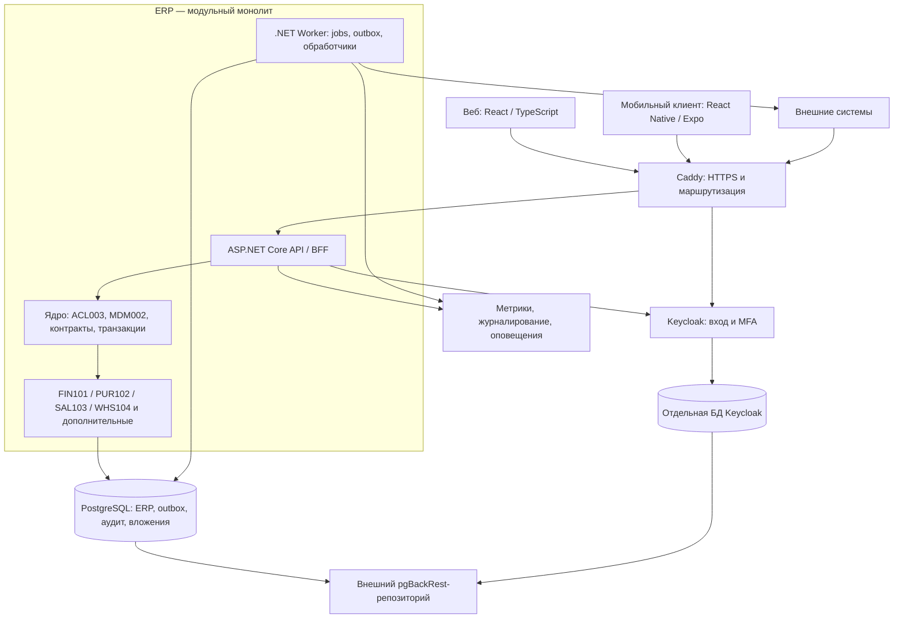

# Технологический стек ERP-системы

**Версия:** 0.1  
**Дата:** 14 ноября 2026 года  
**Статус:** архитектурное предложение, требует проверки прототипом  
**Репозиторий:** [kvg20051/erp](https://github.com/kvg20051/erp)  
**Исходный срез:** [ecb6b033eb73f073974337d1d5c38b36835cb1d7](https://github.com/kvg20051/erp/tree/ecb6b033eb73f073974337d1d5c38b36835cb1d7)

## 1. Рекомендация

Для этой ERP предлагаю **модульный монолит на C# / ASP.NET Core 10 LTS, PostgreSQL 18, веб-интерфейс на React / TypeScript и мобильное приложение на React Native / Expo**.

Серверная система состоит из API и отдельного процесса фоновых задач. Бизнес-модули из ARCHITECTURE.md реализуются как изолированные части одного приложения с публичными контрактами. Критические учётные изменения выполняются в общей транзакции PostgreSQL; уведомления, интеграции и тяжёлые отчёты — после её завершения.

Развёртывание: **Docker Compose + Caddy + Ansible на собственных VM**. Аутентификация: **Keycloak**. Код и управление разработкой на первом этапе остаются в уже созданном **GitHub**.

Это выбор для следующих условий:

- разработку и эксплуатацию первоначально ведёт один человек;
- первая версия рассчитана на 100 зарегистрированных и 30 одновременно активных пользователей;
- требуется корректность финансовых и складских операций;
- нужны веб-интерфейс, API и мобильное приложение;
- независимый выпуск каждого бизнес-модуля пока не является обязательным требованием.

Знание разработчиком конкретных языков пока не установлено. Если уже есть существенный опыт TypeScript или Python, стоимость освоения C# следует сопоставить с преимуществами выбранного варианта до утверждения стека.

## 2. Что учтено из репозитория

Изучены README.md, ARCHITECTURE.md и NFR.md в веб-интерфейсе GitHub. На момент анализа репозиторий содержит документацию и CSV, но не реализацию приложения. Поэтому ниже — проектное решение, а не оценка существующего кода.

| Исходное положение | Влияние на выбор |
|---|---|
| MDB001 — единая база данных | Один PostgreSQL для транзакционных данных ERP; отдельные схемы по владельцам данных |
| MDM002 — общие справочники | Единые идентификаторы организаций, контрагентов, товаров и единиц измерения |
| ACL003 — права доступа | Аутентификация отделена от бизнес-прав; права по организации и объекту проверяются в ERP |
| FIN101, PUR102, SAL103, WHS104 | Требуются транзакции, точные денежные расчёты, контроль конкурентных изменений |
| CTL201–BIA209 — дополнительные модули | Подключение постепенно через контракты, без создания отдельной инфраструктуры для каждого модуля |
| API-шлюз и шина событий на схеме | На старте реализуются средствами входного прокси, API приложения и outbox; отдельный брокер не обязателен |
| NFR-P01–P06 | Индексы, пагинация, измерение SQL, фоновые задания и возможность запуска двух API-экземпляров |
| NFR-A02–A05 | Непрерывное архивирование WAL, внешние резервные копии, проверяемое восстановление |
| NFR-D01–D07 | Атомарное проведение, идемпотентность и надёжная фиксация событий |
| NFR-S01–S09 | MFA, серверные политики доступа, аудит и отзыв сессий |

Основания: [README.md](https://github.com/kvg20051/erp/blob/ecb6b033eb73f073974337d1d5c38b36835cb1d7/README.md), [ARCHITECTURE.md](https://github.com/kvg20051/erp/blob/ecb6b033eb73f073974337d1d5c38b36835cb1d7/ARCHITECTURE.md), [NFR.md](https://github.com/kvg20051/erp/blob/ecb6b033eb73f073974337d1d5c38b36835cb1d7/NFR.md).

### 2.1. Уточнение архитектуры до начала разработки

В ARCHITECTURE.md модули описаны как независимые и связанные через ядро. Предлагаю уточнить смысл этого положения:

> Модули имеют собственную бизнес-логику и владеют своими данными. Взаимодействие выполняется через явные контракты и события. В первой версии модули развёртываются совместно; критические сквозные операции могут использовать общую транзакцию.

Таким образом, независимость означает границы ответственности и отсутствие обращения к чужой реализации. Она пока не означает отдельную БД, отдельную VM или возможность выпускать любой модуль без обновления остальных.

Ядро должно предоставлять общие механизмы: контекст пользователя, контракты, транзакционный контекст, аудит, диспетчеризацию команд и событий. Правила расчёта себестоимости, проводок и резервирования остаются в соответствующих модулях.

API-шлюз не проверяет, разрешено ли конкретному пользователю проводить документ в конкретной организации. Это обязанность приложения.

## 3. Основной стек

| Слой | Выбор | Назначение и причина |
|---|---|---|
| Серверный язык и платформа | C# + .NET 10 LTS | Явная модель предметной области, тип decimal, статическая проверка, длительный срок сопровождения |
| HTTP API | ASP.NET Core | REST API, авторизация, валидация, обработка ошибок и ограничения запросов |
| Доступ к данным | EF Core 10 + Npgsql 10 | Маппинг PostgreSQL, миграции; явные транзакции для проведения |
| Сложные выборки | Параметризованный SQL через Npgsql | Контроль запросов отчётности и массовых операций, когда ORM становится неудобен |
| Основная БД | PostgreSQL 18 с актуальными исправлениями | Транзакционные данные, ограничения целостности, справочники, аудит и outbox |
| Веб-клиент | React + TypeScript + Vite | Внутренняя прикладная система без обязательного SSR; статическая сборка |
| UI-компоненты | Ant Design | Формы, таблицы, диалоги и единообразные элементы бизнес-интерфейса |
| Маршрутизация и данные клиента | React Router + TanStack Query | Навигация, состояние серверных запросов, обновление данных после операций |
| Мобильный клиент | React Native + Expo + TypeScript | Отдельный мобильный интерфейс с повторным использованием API-клиента и части типов |
| Аутентификация | Keycloak через OpenID Connect | Учётные записи, MFA, восстановление доступа и управление входом |
| Бизнес-права | Политики ASP.NET Core + ACL003 | Организация, операция, склад, документ, область данных |
| Фоновые операции | .NET Worker Service + таблицы jobs/outbox/inbox в PostgreSQL | Надёжные импорты, отчёты, интеграции без отдельного брокера на старте |
| Вложения первой версии | PostgreSQL bytea через отдельный интерфейс хранения | Согласованное восстановление вместе с документами; ограничения описаны ниже |
| TLS и маршрутизация | Caddy | HTTPS, статические файлы веб-клиента, проксирование API и входа |
| Развёртывание | Docker Compose + Ansible | Воспроизводимое управление собственными VM |
| CI/CD | GitHub Actions + OCI registry, например GHCR | Проверки, сборка, хранение образов и продвижение проверенной версии |
| Резервирование | pgBackRest + внешнее хранилище | Копии БД, WAL, шифрование и восстановление на момент времени |
| Наблюдаемость | OpenTelemetry + Prometheus + Alertmanager + Grafana | Трассировка, метрики, уведомления и эксплуатационные панели |
| Тестирование | xUnit, Testcontainers, Playwright, k6 | Логика, PostgreSQL-интеграция, пользовательские сценарии и нагрузка |

.NET 10 выбран как LTS-линия с поддержкой до ноября 2028 года. Npgsql 10 предоставляет провайдер для EF Core 10. PostgreSQL 18 — выбранная стабильная линия, а не требование всегда устанавливать самый новый major. Источники: [политика .NET](https://dotnet.microsoft.com/en-us/platform/support/policy), [Npgsql 10](https://www.npgsql.org/efcore/release-notes/10.0.html), [политика PostgreSQL](https://www.postgresql.org/support/versioning/).

Точные patch-версии библиотек и digest контейнеров фиксируются при создании прототипа и обновляются после проверок. Теги latest/main для production не используются.

## 4. Почему такой серверный стек

| Вариант | Преимущества для проекта | Компромисс | Решение |
|---|---|---|---|
| C# / ASP.NET Core | Удобная модель сложных документов и правил, decimal, транзакции, поддерживаемая платформа | Два языка в проекте: C# и TypeScript | Основной вариант |
| TypeScript / NestJS | Общий язык сервера, веба и мобильного клиента | Точные десятичные расчёты требуют отдельной библиотеки и дисциплины; транзакции и runtime-валидация проектируются явно | Сильная альтернатива при хорошем опыте TypeScript |
| Python / Django | Быстрые справочники, административные формы, ORM, Decimal | Для полноценного веб- и мобильного интерфейса всё равно появляется TypeScript; тяжёлые расчёты требуют отдельного внимания | Альтернатива при хорошем опыте Python |
| Java / Spring | Подходит для сложной учётной логики и интеграций | В данном проекте нет подтверждённого преимущества, оправдывающего освоение ещё одной платформы | Выбирать при наличии опыта Java |

Все эти варианты способны обслужить указанный профиль нагрузки. Выбор C# не означает, что другие языки непригодны для ERP; это инженерное предпочтение для текущих требований.

Готовую ERP-платформу также стоит оценить до полной разработки бухгалтерии, зарплаты и налоговой отчётности. Здесь рассматривается собственная реализация по структуре репозитория, а не сравнение готовых ERP. Регламентированный учёт можно первоначально оставить внешней системе с интеграцией.

## 5. Схема исполнения



API и Worker могут собираться из одного репозитория и использовать общие модули, но запускаются разными процессами. Тяжёлый импорт не должен занимать HTTP-процесс.

Веб-сборку обслуживает Caddy; Node.js нужен для сборки фронтенда, а не как дополнительный сервер бизнес-логики.

Два экземпляра API используют общую БД, серверное хранилище сессий и согласованный набор ключей защиты cookie. Состояние, необходимое для продолжения операции, не хранится только в памяти одного экземпляра.

## 6. Реализация модулей и транзакций

### 6.1. Владение данными

Предлагаемые схемы PostgreSQL:

| Схема | Владелец и содержимое |
|---|---|
| core | Технические операции, идемпотентность, задания, outbox, аудит |
| mdm | MDM002: организации, контрагенты, товары, единицы измерения |
| acl | ACL003: привязка пользователя, роли, области доступа |
| fin | FIN101: учётные документы и проводки |
| pur | PUR102: заявки и заказы поставщикам |
| sal | SAL103: клиентские заказы и продажи |
| whs | WHS104: складские движения, остатки, резервы |
| files | Метаданные и содержимое вложений |
| hrm, mfg, ... | Добавляются по мере реализации соответствующих модулей |

Схема БД — способ организации, а не автоматическая гарантия изоляции модулей. Границы контролируются структурой проектов, доступностью типов и архитектурными тестами.

Модуль не изменяет чужие таблицы напрямую. Для изменения чужих данных вызывается публичный контракт владельца через прикладной координатор. Отчётность может читать согласованные представления нескольких модулей отдельной ролью только для чтения.

### 6.2. Проведение документа

Пример для сценария, в котором приёмка должна одновременно сформировать складские движения и финансовые записи:

1. API проверяет пользователя, организацию, полномочия и ключ идемпотентности.
2. Координатор открывает одну транзакцию PostgreSQL.
3. PUR102 проверяет состояние заказа и допустимость приёмки.
4. WHS104 формирует движения и изменяет остатки.
5. FIN101 формирует финансовые записи, предусмотренные утверждёнными правилами.
6. Фиксируются состояние документа, аудит, результат операции и запись outbox.
7. Выполняется commit.
8. Worker обрабатывает уведомления и внешние интеграции.

Внутри этой транзакции нельзя ожидать сеть, LLM, почту или стороннюю бухгалтерскую систему.

Если используются отдельные DbContext модулей, они явно включаются в одну общую DbConnection/DbTransaction. Несколько самостоятельных SaveChanges в разных контекстах сами по себе не дают общей атомарности. Возможность совместного использования транзакции описана в [EF Core Transactions](https://learn.microsoft.com/en-us/ef/core/saving/transactions).

При дальнейшем выделении модулей в сервисы общая транзакция исчезнет. Тогда придётся отдельно согласовать промежуточные состояния, компенсации и изменение требований к атомарности. Это не автоматическое преобразование монолита в микросервисы.

### 6.3. Деньги и конкурентные операции

- Серверные суммы рассчитываются в C# decimal; в PostgreSQL применяется numeric(p,s), а не float/double.
- Точность определяется по полям: например, сумма numeric(18,4), количество numeric(18,6). Это проектные примеры, подлежащие сверке с валютами и правилами округления.
- Денежные значения в JSON передаются десятичными строками; клиент не становится источником окончательных учётных сумм.
- Изменение карточек защищается явной версией записи; конфликт возвращается как HTTP 409.
- Резервирование и списание проверяются внутри транзакции с подходящими блокировками или условным обновлением.
- Ключ идемпотентности привязан к организации, типу операции и содержимому запроса. Повтор ключа с другим содержимым отклоняется.
- Учётная дата хранится отдельно от технической временной метки.
- Проведённые движения исправляются через предусмотренную бизнес-моделью отмену или корректировку с сохранением истории.

PostgreSQL numeric поддерживает точные десятичные значения; конкретные правила округления остаются частью реализации ERP. [Документация числовых типов](https://www.postgresql.org/docs/18/datatype-numeric.html).

## 7. Шина событий и фоновые задания

Для первоначальной нагрузки достаточно PostgreSQL и .NET Worker. Это реализация логической шины из архитектуры, без отдельного сетевого брокера.

Потребуются:

- outbox: событие записывается в той же транзакции, что и бизнес-операция;
- задания со статусами, временем следующей попытки и ограничением числа повторов;
- блокировка или lease на обработку задания, восстановление после падения worker;
- inbox либо другой механизм фиксации уже обработанного события;
- идентификатор события, версия контракта, correlation ID, организация;
- очередь ошибок с возможностью просмотра и управляемого повторного запуска.

Доставка — как минимум один раз. Поэтому каждый обработчик проектируется с учётом повторов. Запись «отправлено» после сетевого вызова не устраняет возможность повторной доставки при аварии.

Прикладной worker использует BackgroundService, но эта библиотечная абстракция сама не обеспечивает долговечность очереди. Надёжность обеспечивают таблицы, транзакции, алгоритм захвата заданий и тесты отказов. [Фоновые службы .NET](https://learn.microsoft.com/en-us/aspnet/core/fundamentals/host/hosted-services?view=aspnetcore-10.0).

Отдельный RabbitMQ рассматривается при появлении независимо развёртываемых потребителей или измеренной необходимости в специализированной доставке. Outbox при этом сохраняется. Kafka, Kubernetes и отдельный workflow-движок не включаются в первую версию.

## 8. Веб и мобильное приложение

### Веб

React + TypeScript, Vite, React Router, TanStack Query и Ant Design.

Vite подходит для выбранной SPA-модели. При этом маршрутизацию, запросы, обработку ошибок и структуру приложения нужно стандартизировать сразу: React сам по себе этого не решает. SSR и SEO в исходных требованиях внутренней ERP не заявлены. Источники: [React о сборке приложения](https://react.dev/learn/build-a-react-app-from-scratch), [Ant Design](https://ant.design/docs/react/introduce/).

Особенности реализации:

- единые шаблоны списка, карточки документа и согласования;
- серверная пагинация, фильтрация и сортировка;
- маршруты группируются по бизнес-модулям;
- отображение состояния длительной операции;
- сохранение корректного ввода при ошибке;
- проверка прав сервером независимо от видимости кнопок;
- OpenAPI-контракт и генерируемый TypeScript-клиент;
- единый формат ошибок с машинным кодом и correlation ID.

### Мобильный клиент

React Native + Expo; собственные экраны для согласования, приёмки, поиска и других мобильных сценариев.

Повторно используются API-клиент, типы, часть правил представления и форматирования. Web-компоненты Ant Design напрямую в React Native не переносятся.

Первый мобильный этап — после стабилизации API и основного веб-сценария. До этого адаптивный веб-интерфейс позволяет проверить процессы, но не заменяет обязательства по выпуску приложения.

Приложение должно различать «не отправлено», «результат неизвестен» и «выполнено». Полноценный offline пока не входит в NFR; при его добавлении потребуется отдельный проект синхронизации и локального защищённого хранения.

Сборка возможна на собственном оборудовании. Для iOS требуется macOS/Xcode; одной Ubuntu VM для всей мобильной сборки недостаточно. [Локальная разработка Expo](https://docs.expo.dev/guides/local-app-development/).

## 9. Вход, полномочия и аудит

Keycloak отвечает за подтверждение личности, MFA, вход и восстановление доступа. ACL003 отвечает за бизнес-полномочия. Идентификатор пользователя ERP связывается с issuer/sub из OIDC, а не только с email.

Предлагаемая схема:

- веб: OIDC-вход через ASP.NET Core BFF, браузер получает защищённую HttpOnly/Secure cookie; изменяющие запросы защищены от CSRF;
- мобильный клиент: Authorization Code + PKCE через системный браузер;
- машинные интеграции: отдельные клиенты с ограниченными правами;
- привязка организации проверяется сервером; переданный клиентом organization_id не является доказательством доступа;
- токены и пароли не записываются в журналы.

Keycloak поддерживает OIDC и OTP/WebAuthn; конкретные политики MFA и сессий необходимо настроить. [Руководство Keycloak](https://www.keycloak.org/docs/latest/server_admin/).

Для NFR-S09 нельзя полагаться только на проверку подписи долгоживущего JWT. Нужны общие отзываемые сессии ERP, проверка статуса пользователя и ограниченный срок кеширования проверки сессии у IdP. Предлагаемый предел кеша — 60 секунд; при невозможности подтвердить действительность сессии доступ закрывается. Сценарии блокировки в ERP и Keycloak проверяются отдельно с целевым пределом 5 минут.

Разграничение по организациям реализуется на прикладном уровне и усиливается PostgreSQL RLS для критических таблиц. При RLS runtime-роль не должна быть владельцем таблиц, superuser или иметь BYPASSRLS. Контекст организации задаётся в пределах транзакции, чтобы не переноситься между запросами в пуле соединений. RLS не заменяет проверку бизнес-действий. [PostgreSQL Row Security](https://www.postgresql.org/docs/18/ddl-rowsecurity.html).

Аудит хранится отдельно от технических логов. Бизнес-роль не имеет UPDATE/DELETE к журналу; runtime получает только необходимый путь добавления. Такая схема не делает данные неуязвимыми для администратора БД — для более строгого требования потребуется независимое хранилище аудита.

В репозитории присутствует employees.csv; описание коммита упоминает адреса и паспортные поля. Подлинность данных не устанавливалась, значения для выбора стека не использовались. Тестовые fixtures должны быть синтетическими; если файл содержит реальные данные, их нельзя использовать как публичные демонстрационные данные проекта.

## 10. Вложения, поиск и отчётность

### Вложения первой версии

Предлагаю хранить содержимое в отдельной таблице PostgreSQL bytea с метаданными, контрольной суммой, версией и привязкой к владельцу документа.

Причина — исходный объём 50 ГБ и требование согласованного восстановления БД и вложений с RPO 15 минут. Одна система хранения упрощает выполнение этого требования и запуск двух API-экземпляров.

Ограничения этого решения:

- предлагаемый лимит одного файла — 20 МиБ, подлежит согласованию;
- бинарные данные не выбираются вместе со списком документов и не отслеживаются ORM в обычных запросах;
- параллельные загрузки ограничиваются; использование памяти и рост WAL измеряются;
- вложения увеличивают размер резервных копий и время восстановления;
- включается проверка типа и размера, карантин и антивирусная проверка загружаемых файлов;
- получение файла всегда проходит проверку прав.

Это ограниченное стартовое решение, а не универсальная рекомендация хранить любые файлы в БД. Если нужны крупные файлы, видео или большой поток загрузок, следует сразу выбрать отдельное S3-совместимое хранилище.

Интерфейс хранения предусматривает такую замену. При переходе на S3 отдельно проектируются версии объектов, независимая резервная копия и восстановление ссылок БД на существующие версии файлов. Репликация или versioning сами по себе не заменяют резервное копирование.

### Поиск и отчётность

В первой версии — индексы PostgreSQL, обычный и полнотекстовый поиск по согласованным полям, SQL-представления и фоновые отчёты.

Бухгалтерские и складские регистры отделяются от произвольных BI-дашбордов. Если отчёт отражает данные с задержкой, интерфейс показывает время актуальности.

Отдельный поисковый кластер и аналитическая БД добавляются при измеренной необходимости. Для BIA209 сначала создаётся договорённая модель показателей и read-only представления. Подключать BI напрямую ко всем рабочим таблицам с широкими правами не следует.

## 11. Развёртывание и резервирование

### Начальная топология

| Узел | Состав |
|---|---|
| Development | Среда разработчика, тестовые контейнеры, синтетические данные |
| Staging | Отдельная среда с теми же версиями компонентов и изолированными секретами |
| Production App VM | Caddy, API, Worker, Keycloak; PostgreSQL может быть здесь только в экономном пилоте |
| Production Data VM | Предпочтительное отдельное размещение PostgreSQL; БД ERP и Keycloak разделены ролями |
| Backup host / storage | Зашифрованные копии вне production-хоста и отдельные полномочия доступа |
| CI runner | Отдельная среда сборки; не размещается на production VM |

На одном хосте Compose достаточен для первоначального развёртывания. Несколько VM управляются отдельными Compose-проектами и Ansible; Compose не превращается от этого в кластерный оркестратор. [Docker Compose в production](https://docs.docker.com/compose/how-tos/production/).

Точные CPU/RAM/SSD определяются после прототипа: нагрузка из NFR не описывает сложность отчётов, индексы, частоту импорта и объём WAL. Имеющуюся VM WUXU не следует считать автоматически подходящей для ERP production: разные системы должны иметь отдельные данные, секреты и эксплуатационные границы.

### Резервирование

PostgreSQL + pgBackRest: регулярные базовые копии и непрерывная отправка WAL во внешнее хранилище. Проверяется отставание внешнего архива, а не только факт успешного ночного backup. Допустимое отставание должно оставлять запас до RPO 15 минут.

Дополнительно сохраняются конфигурация развёртывания, БД Keycloak и необходимые ключи восстановления; секреты хранятся отдельно и защищённо. Копии шифруются, восстановление регулярно проверяется на другой машине. Источники: [PostgreSQL PITR](https://www.postgresql.org/docs/18/continuous-archiving.html), [pgBackRest](https://pgbackrest.org/user-guide.html).

### Противоречие в целевых показателях

**99,5% доступности допускает около 3 часов 36 минут простоя за 30-дневный месяц.** При этом NFR допускает RTO до 4 часов. Одна авария с восстановлением за все 4 часа уже нарушит месячный показатель, даже без плановых работ.

До production нужно согласовать одно из решений:

- сохранить 99,5% и целиться в существенно более короткое восстановление, добавить подготовленный резерв и проверить переключение;
- оставить экономную одиночную систему и явно пересогласовать допустимую доступность;
- уточнить, что RTO 4 часа относится к катастрофическому сценарию, и отдельно согласовать правила его учёта в SLO.

Последний вариант нельзя вводить молча: действующий NFR включает плановые работы и не содержит такого исключения. Два контейнера API на одной VM защищают от части программных сбоев, но не от отказа самой VM, БД или прокси.

## 12. Разработка и CI/CD

Поскольку репозиторий уже находится в GitHub, предлагаю начать с Issues, Projects, Pull Requests, Actions и registry. Переезд на GitLab не требуется только ради размещения приложения на собственных VM.

Если требование «на своих серверах» распространяется также на код, задачи и CI, целевой вариант — GitLab Self-Managed с отдельным Runner. Это отдельное решение об инфраструктуре разработки; рабочие контейнеры ERP от него не зависят.

Процесс выпуска:

1. Требование и критерии приёмки в Issue.
2. Изменение спецификации и ADR, если меняется архитектура.
3. Ветка и Pull Request.
4. Проверка форматирования, типов, unit- и integration-тестов.
5. Проверка контрактов OpenAPI и миграций PostgreSQL.
6. Проверка зависимостей, секретов и контейнеров.
7. Однократная сборка образов и фиксация digest.
8. Развёртывание этих образов на staging.
9. Проверка критического сквозного сценария.
10. Явный запуск production-развёртывания тех же образов.
11. Smoke test и готовый план отката.

Изменения схемы выполняются отдельным шагом, а не одновременно при старте всех реплик API. Для совместимости релизов используется последовательность «расширить схему → обновить приложение → позднее убрать старую структуру».

Self-hosted runner не получает право исполнять непроверенные внешние Pull Requests с доступом к production. Сборка и развёртывание разделяются по полномочиям. Это особенно существенно для текущего публичного репозитория. [GitHub Actions: безопасное использование](https://docs.github.com/en/actions/reference/security/secure-use).

### Предлагаемая структура репозитория

```text
erp/
├── README.md
├── ARCHITECTURE.md
├── NFR.md
├── TECH_STACK.md
├── docs/
│   ├── requirements/
│   ├── specifications/
│   ├── adr/
│   └── runbooks/
├── src/
│   ├── Erp.Api/
│   ├── Erp.Worker/
│   ├── Erp.Kernel/
│   ├── Erp.Processes/
│   └── Modules/
│       ├── Mdm/
│       ├── Access/
│       ├── Finance/
│       ├── Purchasing/
│       ├── Sales/
│       └── Warehouse/
├── apps/
│   ├── web/
│   └── mobile/
├── contracts/
│   └── openapi/
├── tests/
│   ├── unit/
│   ├── integration/
│   ├── architecture/
│   ├── e2e/
│   └── load/
├── infra/
│   ├── compose/
│   ├── ansible/
│   └── monitoring/
└── .github/
    └── workflows/
```

Erp.Processes содержит координаторы сквозных сценариев и зависит от контрактов модулей. Erp.Kernel не должен со временем превращаться в место хранения всей бизнес-логики.

## 13. Проверка NFR выбранным стеком

| Требования | Механизм | Как подтвердить |
|---|---|---|
| P01–P03 | Индексы, SQL-профилирование, ограничение выдачи | k6 на профиле NFR, отчёт p95 и ошибок |
| P04–P05 | Worker, статусы jobs, серверная пагинация | Длительный импорт не блокирует интерфейс |
| P06 | Два API, общие сессии и данные, согласованные ключи cookie | Отключить один API и продолжить работу |
| A01–A06 | Внешний мониторинг, backups/WAL, тайм-ауты | Учебная авария и восстановление с замером |
| D01–D07 | PostgreSQL-транзакции, версии, ограничения, outbox/inbox | Повторы, конкуренция и падение между этапами |
| D08 | Отдельные учётные даты и техническое время | Границы суток и периодов |
| S01–S09 | Keycloak, ACL003, RLS, аудит, отзываемые сессии | Запрет доступа к чужой организации, MFA, отзыв |
| I01–I06 | OpenAPI, версионирование, идемпотентность | Совместимость клиентов, повтор после потери сети |
| U01–U03 | Единые UI-шаблоны и состояния | Playwright и ручные сценарии в матрице браузеров |
| O01–O04 | OpenTelemetry, метрики, уведомления, runbooks | От запроса найти сбой, получить оповещение |
| M01–M06 | Git, CI, неизменяемые образы, миграции | Полный staging→production→rollback сценарий |

OpenTelemetry даёт инструменты сбора телеметрии, но набор бизнес-метрик, хранение и оповещения нужно реализовать и настроить отдельно. [OpenTelemetry .NET](https://opentelemetry.io/docs/languages/dotnet/).

Ни один компонент сам по себе не подтверждает выполнение NFR. В частности, PostgreSQL не гарантирует нужные p95/RPO/RTO без схемы данных, настройки, инфраструктуры и испытаний.

## 14. Порядок реализации

### Этап 1. Проверка основы

Создать API, веб-клиент, Keycloak, PostgreSQL и pipeline staging.

Проверить вход с MFA, доступ к одной организации, миграцию, backup/restore и работу двух API-экземпляров. До этого не начинать параллельную реализацию всех модулей.

### Этап 2. Один сквозной процесс

MDM002 + ACL003 + минимальные части PUR102, WHS104 и FIN101:

> Заявка → заказ поставщику → частичная приёмка → складские движения → финансовое отражение → корректировка.

Критерий готовности — не количество экранов, а корректность частичной приёмки, повторной отправки, конкуренции, отказа прав и отмены операции.

### Этап 3. Проверка эксплуатационной готовности

Заполнить тестовую БД до объёма NFR, провести нагрузку и восстановление, проверить отзыв доступа, аудит и развёртывание новой версии.

На этом этапе принять решение о достаточности хранения вложений в PostgreSQL и о резервном узле.

### Этап 4. Продажи и мобильные сценарии

Добавить SAL103 и мобильные задачи после стабилизации контрактов. Затем расширять FIN101 и остальные модули по бизнес-приоритету.

### Этап 5. Расширение по измеренным потребностям

Отдельный брокер, аналитическая БД, объектное хранилище, поисковый движок или выделение сервисов вводятся по конкретной проблеме с измеримым критерием, а не потому, что модулей стало много.

## 15. Роль WUXU и решения до старта

Существующий WUXU / LiteLLM полезен для разработки и будущих функций анализа документов, но не входит в обязательный путь проведения ERP-документов.

Возможная будущая интеграция: отдельный серверный AI-адаптер, отдельный ключ ERP, бюджет, тайм-аут и аудит. Пользователь должен видеть, что результат ИИ — предложение; финансовые действия проходят обычные проверки и подтверждение. Отказ LLM не блокирует учётные операции.

Перед созданием каркаса нужно зафиксировать:

1. Принимается ли C# как серверный язык.
2. Какой сквозной бизнес-процесс реализуется первым.
3. Должен ли регламентированный учёт выполняться внутри ERP или во внешней системе.
4. Достаточен ли предложенный лимит вложений и нужен ли offline на мобильном устройстве.
5. Что означает самостоятельное размещение: только production или также Git/CI.
6. Как согласуются доступность 99,5%, RTO 4 часа и бюджет резервирования.

**Решение для фиксации в ADR:** модульный монолит, общий PostgreSQL и атомарные учётные операции; ASP.NET Core 10 LTS, React/TypeScript, React Native/Expo, Keycloak; Docker Compose и Ansible; расширение инфраструктуры после проверки нагрузкой.
