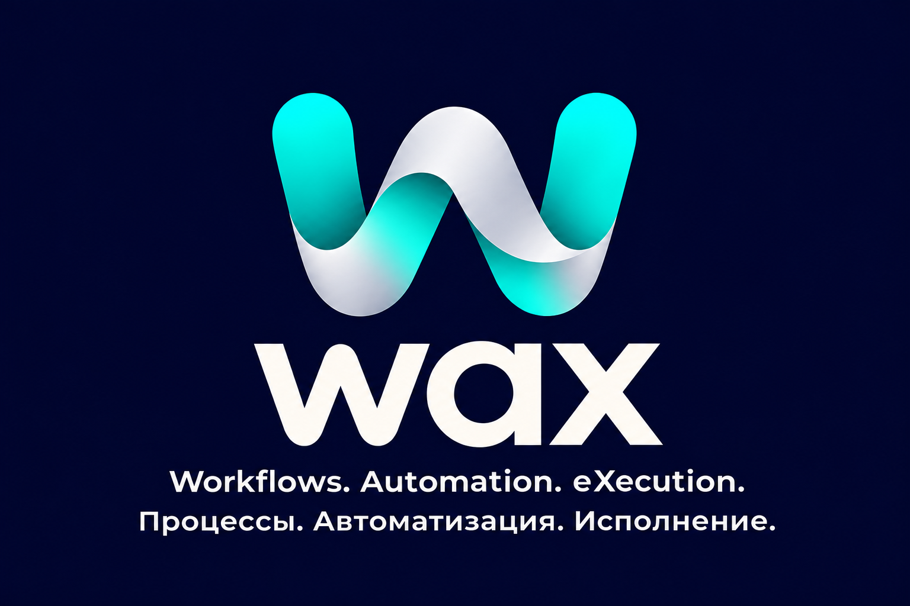

# wax — название и оформление системы

**Домен портала:** [wax.su](https://wax.su)

**WAX — Workflows. Automation. eXecution.**

*Процессы. Автоматизация. Исполнение.*

Название системы и написание логотипа: **wax**. В расшифровке слогана используется **WAX**. В английском слове **eXecution** сохраняется заглавная X. Английский и русский слоганы приводятся дословно.

## Где применяется

Веб-интерфейс, заголовок вкладки, экран входа, отображаемые имена приложения в Keycloak, OpenAPI, PDF-формы, имя листа Excel и документация используют wax/WAX. Архивы поставки называются wax-source.tar.gz и wax-prototype-0.1.zip.

## Совместимость существующих установок

Схема, идентификаторы и бизнес-операции сохраняются. Миграция V2 обновляет только три неизменённых демонстрационных названия: два юрлица и тестовый товар. Пользовательские переименования не затрагиваются; исходная миграция V1 не изменяется. Служебные идентификаторы прежнего прототипа сохранены:

| Назначение | Сохранённое значение |
|---|---|
| Compose project | `nixu` |
| PostgreSQL БД и роли | `nixu`, `nixu_owner`, `nixu_app` |
| Docker volumes | `nixu_postgres`, `nixu_files` |
| Keycloak realm / client / audience | `nixu` / `nixu-web` / `nixu-api` |
| Ansible inventory group / переменные | `nixu` / `nixu_*` |
| Корень развёртывания | `/opt/nixu` |
| Java package / исполняемый JAR | `ru.nixu` / `nixu-0.1.0.jar` |
| Совместимая конфигурация браузера | `window.NIXU_CONFIG` |

Поэтому команды и пути с этими идентификаторами в технической документации корректны. Не переименовывайте volumes, БД или realm простой заменой текста: это создаст отдельный набор ресурсов или нарушит вход.

При новой установке Keycloak получает отображаемое имя `wax ERP`. Если realm уже существует, импорт не перезаписывает его: измените только **Realm settings → General → Display name** на `wax ERP` и отображаемое имя клиента `nixu-web` на `wax web`. Realm name, Client ID и audience сохраняются.

Изменение домена существующего realm требует отдельного обновления redirect URI и web origins; этот ребрендинг не подтверждает выполнение таких изменений на VPS.

## Логотип

Логотип сохранён в assets/branding/wax-logo.png. Использован встроенный image_gen, редактирование прежнего логотипа с заменой эмблемы, названия и слогана. Точный запрос сохранён рядом в wax-logo-prompt.txt.
